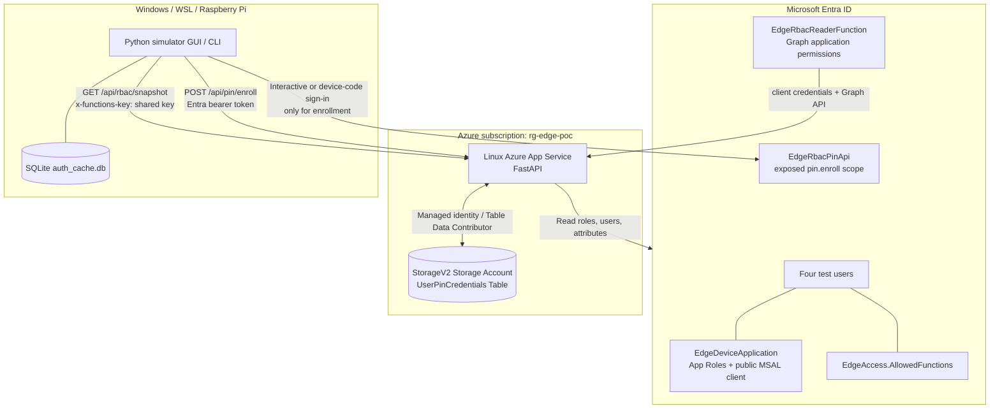

# Azure Portal End-to-End Setup and Validation Guide

## Centralized Entra RBAC + Cloud PIN + Offline Edge Simulator POC (FastAPI / Simulator )

**Document purpose:** Rebuild this exact proof of concept from a clean Microsoft Entra tenant and Azure subscription, deploy the working code, diagnose the problems we encountered, and demonstrate successful cloud PIN enrollment, bulk synchronization, and offline authorization on Windows, WSL, or Raspberry Pi.

**Last reviewed:** 15 November 2026  
**Primary method:** Azure Portal + Microsoft Entra admin center, with optional command-line recovery commands.  
**Code baseline:** `Edge_RBAC_FastAPI__Bulk_Snapshot_Deploy.zip` and `Edge_RBAC_Simulator__Bulk_PIN_Windows_WSL_RaspberryPi.zip` (not v2, v3, v4, or the previous Part C package).  
**Audience:** Engineer or administrator implementing the POC for the first time.  
**Security classification:** **Controlled lab/POC only**—the shared bulk-sync API key enables download of every enrolled user's salted PIN verifier.

> **Important:** Portal menu labels occasionally move. This guide gives both the service name and the expected page/setting. Use the Azure or Entra search box if the menu has moved. Do **not** expose client secrets, API keys, plaintext PINs, raw access tokens, or downloaded verifier values in screenshots, Git commits, tickets, or support messages.

---

## Contents

1. [Read this first: target architecture and what to create](#1-read-this-first-target-architecture-and-what-to-create)
2. [Prepare the tenant, subscription, permissions, and values worksheet](#2-prepare-the-tenant-subscription-permissions-and-values-worksheet)
3. [Create the Azure resource group](#3-create-the-azure-resource-group)
4. [Register the desktop application and define App Roles](#4-register-the-desktop-application-and-define-app-roles)
5. [Create test users and assign them to the Enterprise Application](#5-create-test-users-and-assign-them-to-the-enterprise-application)
6. [Create custom security attributes and assign function permissions](#6-create-custom-security-attributes-and-assign-function-permissions)
7. [Register the backend Microsoft Graph reader and grant consent](#7-register-the-backend-microsoft-graph-reader-and-grant-consent)
8. [Register the protected PIN enrollment API and delegated scope](#8-register-the-protected-pin-enrollment-api-and-delegated-scope)
9. [Create the Azure Storage Account and PIN table](#9-create-the-azure-storage-account-and-pin-table)
10. [Create the Linux Python App Service](#10-create-the-linux-python-app-service)
11. [Enable managed identity and grant Azure Table data access](#11-enable-managed-identity-and-grant-azure-table-data-access)
12. [Configure the App Service environment and startup](#12-configure-the-app-service-environment-and-startup)
13. [Deploy FastAPI and verify Swagger](#13-deploy-fastapi-and-verify-swagger)
14. [Validate bulk API, Graph permissions, and table connectivity](#14-validate-bulk-api-graph-permissions-and-table-connectivity)
15. [Install and test the edge simulator](#15-install-and-test-the-edge-simulator)
16. [Test PIN enrollment, bulk synchronization, and offline login end to end](#16-test-pin-enrollment-bulk-synchronization-and-offline-login-end-to-end)
17. [Troubleshooting: actual problems from this POC](#17-troubleshooting-actual-problems-from-this-poc)
18. [Security, maintenance, cost, and cleanup](#18-security-maintenance-cost-and-cleanup)
19. [Final acceptance checklist](#19-final-acceptance-checklist)
20. [Official Microsoft documentation](#20-official-microsoft-documentation)

---

## 1. Read this first: target architecture and what to create

### 1.1 Final design—not the superseded prototypes



### 1.2 Exact resources and why they exist

| Resource or identity                         | Suggested name                                     | Why it exists                                                        | Create?         |
| -------------------------------------------- | -------------------------------------------------- | -------------------------------------------------------------------- | --------------- |
| Microsoft Entra tenant                       | Use existing test tenant                           | Directory of users and app registrations                             | Yes, or reuse   |
| Azure subscription                           | Existing active subscription                       | Pays for App Service and Storage                                     | Yes, or reuse   |
| Resource group                               | `rg-edge-poc`                                      | Holds the Azure resources                                            | Yes             |
| Entra App Registration #1                    | `EdgeDeviceApplication`                            | Public desktop sign-in, application roles and enterprise assignments | Yes             |
| Entra App Registration #2                    | `EdgeRbacReaderFunction`                           | Confidential backend app for Microsoft Graph                         | Yes             |
| Entra App Registration #3                    | `EdgeRbacPinApi`                                   | Audience and delegated scope for authenticated PIN enrollment        | Yes             |
| Entra custom security attribute set          | `EdgeAccess`                                       | Fine-grained authorization flags                                     | Yes             |
| Attribute                                    | `AllowedFunctions`                                 | Multi-valued string of function permissions                          | Yes             |
| Storage Account                              | Globally unique, e.g. `stedgepocpin001` if free    | Table Storage for cloud PIN verifiers                                | Yes             |
| Storage table                                | `UserPinCredentials`                               | Stores a single PIN credential record per user                       | Yes             |
| App Service plan                             | New Linux plan, preferably Basic for POC           | Compute for FastAPI                                                  | Yes             |
| App Service                                  | Globally unique, e.g. `app-edge-rbac-poc-<suffix>` | Hosts backend                                                        | Yes             |
| App Service system-assigned managed identity | Created on the App Service                         | Authenticates to Azure Table Storage without a storage key           | Enable          |
| Azure RBAC role                              | `Storage Table Data Contributor`                   | Permits the managed identity to read/write table entities            | Assign          |
| Edge simulator                               | Local Python installation                          | GUI, bulk sync, offline login and optional telemetry                 | Install locally |

**You do not need** an Azure Function App, Function Key, Azure SQL Database, Azure Cosmos DB, Azure API Management, an `EdgeDevices` table, a device-specific RBAC ID, or a per-device SHA-256 registry for the _current core POC_. A historical Function App approach was abandoned after provisioning/deployment difficulties; the current backend runs on **Azure App Service**. An **optional** Azure IoT Hub telemetry branch can be set up separately and is not required for RBAC or PIN testing.

### 1.3 Final API contract: verify before doing any work

| HTTP method | URL path             | Auth                                                 | Expected purpose                                                                      |
| ----------- | -------------------- | ---------------------------------------------------- | ------------------------------------------------------------------------------------- |
| `GET`       | `/`                  | Public                                               | Service identifier                                                                    |
| `GET`       | `/health`            | Public                                               | Process liveness only—not a full dependency check                                     |
| `GET`       | `/api/rbac/snapshot` | `x-functions-key` containing `RBAC_API_KEY`          | **One download of all directly assigned users plus RBAC and available PIN verifiers** |
| `POST`      | `/api/pin/enroll`    | Entra access token with `pin.enroll` delegated scope | First-time cloud PIN enrollment by the _signed-in user_                               |

The current code returns **`schemaVersion: 4`**, even though the backend package is called . These are different version numbers.

### 1.4 Three flows to understand before provisioning

**Bulk sync:** Edge simulator → HTTPS `GET /api/rbac/snapshot` + shared API key → FastAPI → Graph users/roles/attributes + Azure Table active PIN verifiers → one JSON `users[]` → local SQLite. **No per-user sign-in and no device registration** for this read operation.

**First-time enrollment:** Individual user → Browser Sign-In or Device Code Flow → access token for `EdgeRbacPinApi` → `POST /api/pin/enroll` → FastAPI identifies token `oid`, checks the user's App Role assignment, stores a salted scrypt verifier in Table Storage → simulator refreshes bulk snapshot. The shared API key cannot enroll or replace PINs.

**Offline login:** Select a previously synchronized user → enter PIN → validate against local salted scrypt verifier → check both PIN and RBAC expiry, lockout, and effective permissions → allow only authorized simulated functions. No network or Entra sign-in is needed **until the cached data expires**.

---

## 2. Prepare the tenant, subscription, permissions, and values worksheet

### 2.1 Open the correct portals

1. Sign in to **https://portal.azure.com** (Azure resources).
2. Open a separate tab for **https://entra.microsoft.com** (tenant, app registrations, users, enterprise app roles).
3. At the top of both portals, check **Directories + subscriptions / Switch directory**. Select the _same_ test tenant and subscription throughout.
4. In Azure Portal, go to **Subscriptions**, open your chosen subscription, and confirm its status is **Active** and you have permission to create resource groups and services.
5. In Entra → **Overview**, record **Tenant ID** and tenant domain (e.g., `yourtenant.onmicrosoft.com`).
6. Never mix client IDs or consent from another tenant. If `No subscriptions found` appears, check directory context, subscription association, access, and trial/subscription eligibility before continuing.

### 2.1A If starting from no tenant or subscription (optional)

If you already have a **test workforce tenant** and an **active Azure subscription associated with that tenant**, skip this subsection. Do not create a duplicate tenant merely because you cannot locate a subscription; first check **Switch directory**.

**Create a new workforce tenant when your account/billing arrangement permits it:**

1. Azure Portal → **Microsoft Entra ID → Overview → Manage tenants → Create**.
2. Select **Microsoft Entra ID / Workforce** (not a consumer-oriented External ID tenant).
3. Enter organization name, globally unique initial `*.onmicrosoft.com` domain prefix, and country/region.
4. Use **Review + create → Create**, then switch to the new directory.
5. Record its **Tenant ID**, tenant domain, and at least one appropriately protected administrative identity.
6. If the tenant creation option is disabled, check tenant creator permissions **and billing eligibility**. Microsoft documents that creating additional workforce tenants is restricted for some free/trial customers; use an existing permitted tenant rather than attempting to circumvent this restriction.

**Ensure that an Azure subscription is associated with the chosen tenant:**

1. Azure Portal → **Subscriptions** and inspect the **Directory** and **Status** of the subscription you intend to use.
2. If your organization has no subscription, a billing/subscription administrator can create one through **Subscriptions → Add** where supported by its billing agreement, then choose the proper directory and owner. Billing-level subscription creator privileges may be required.
3. Subscription creation differs between Microsoft Customer Agreement, Enterprise Agreement, and other billing types; follow the specific billing workflow for your organization rather than assuming every admin can create one.
4. Verify the subscription now appears while switched to the new tenant and that its status is **Active**.
5. **Important:** Creating an Entra tenant does **not** automatically provision a working paid Azure subscription; the two resources are distinct.

Official references: [Create new Entra tenant](https://learn.microsoft.com/en-us/entra/fundamentals/create-new-tenant) and [Create a Microsoft Customer Agreement subscription](https://learn.microsoft.com/en-us/azure/cost-management-billing/manage/create-subscription).

### 2.2 Required administrator capabilities

The person following this guide needs, directly or through help from an administrator:

- Permission to create app registrations and service principals, and assign app roles / test users (`Application Administrator`, `Cloud Application Administrator`, ownership and/or related directory roles depending on the operation).
- Administrator consent for Microsoft Graph **application permissions** and `EdgeRbacPinApi` delegated scope. In some tenants, a privileged directory role is needed for this approval.
- **Attribute Definition Administrator** to create the custom security attribute set/definition.
- **Attribute Assignment Administrator** to assign custom security attribute values to users. **Global Administrator alone does not implicitly receive these attribute-specific permissions.**
- Azure subscription **Contributor/Owner** for creating resources; a role with `Microsoft.Authorization/roleAssignments/write` (such as **User Access Administrator**, **Role Based Access Control Administrator**, or **Owner**, as applicable) to give the App Service managed identity Storage access.

**Do not assume** Entra **Global Administrator** also means Azure subscription **Owner**. Microsoft Entra directory roles and Azure resource RBAC are different systems.

### 2.3 Worksheet: record identifiers while configuring

| Item                                                         | Where found                        | Value                                        |
| ------------------------------------------------------------ | ---------------------------------- | -------------------------------------------- |
| Tenant ID                                                    | Entra → Overview                   | `________________`                           |
| Tenant domain                                                | Entra → Overview                   | `________________`                           |
| Subscription ID                                              | Azure → Subscriptions              | `________________`                           |
| Resource group                                               | Created in §3                      | `rg-edge-poc`                                |
| `EdgeDeviceApplication` **Application (client) ID**          | App registrations → Overview       | `________________`                           |
| `EdgeDeviceApplication` **Enterprise Application Object ID** | Enterprise applications → Overview | `________________`                           |
| `EdgeRbacReaderFunction` **Application (client) ID**         | App registrations → Overview       | `________________`                           |
| `EdgeRbacReaderFunction` **Client Secret VALUE**             | Certificates & secrets: copy once  | Store in secret vault; **not here**          |
| `EdgeRbacPinApi` **Application (client) ID**                 | App registrations → Overview       | `________________`                           |
| Storage account name                                         | Storage → Overview                 | `________________`                           |
| Table endpoint                                               | Storage → Endpoints                | `https://<account>.table.core.windows.net`   |
| App Service full default host                                | App Service → Overview             | `https://________________.azurewebsites.net` |
| `RBAC_API_KEY`                                               | Generate a random key              | Store securely; **not here**                 |

**Existing POC identifiers (use only when continuing that same tenant):**

```text
EdgeDeviceApplication client ID:
345e4a42-6fba-4c4f-b458-9e25d104aee7

EdgeDeviceApplication ENTERPRISE application (service principal) Object ID:
a50685d0-4369-4e5e-95a1-2033a818c52a

EdgeRbacPinApi client ID:
6fcce3c0-2437-4f54-ad20-5010055defc8

Previously used resource group:
rg-edge-poc

Previously used App Service default hostname:
app-edge-rbac-poc--cxgkevamdbb2ckfw.centralindia-01.azurewebsites.net
```

**Do not hardcode these POC IDs into a newly created tenant**—new registrations will have new IDs. The backend's `EDGE_APP_SP_OBJECT_ID` takes the **Enterprise Application Object ID**, _not_ the desktop app's client ID or App Registration object ID.

**Checkpoint 2:** You can access the chosen tenant and subscription, and you have identified who can provide app-role assignment, Graph consent, custom-attribute management, and Azure Storage role assignment.

---

## 3. Create the Azure resource group

1. In Azure Portal, search for **Resource groups**.
2. Click **+ Create**.
3. Choose the correct **Subscription**.
4. **Resource group name:** `rg-edge-poc`.
5. **Region:** `Central India` (or the region where you plan to host the App Service and Storage).
6. Click **Review + create**, check validation, then **Create**.
7. Open the new resource group; at this stage its **Resources** list may be empty.

**Why now?** Creating the group first gives every infrastructure resource a clear, consistent destination. Entra App Registrations live at the _directory_ level and will not appear under this Azure resource group.

**Checkpoint 3:** `rg-edge-poc` exists in the correct subscription.

---

## 4. Register the desktop application and define App Roles

This identity is the logical **edge application**, not an individual Windows/WSL/Pi device. Thousands of simulated devices can use the same public client ID.

### 4.1 Create `EdgeDeviceApplication`

1. Entra admin center → **Entra ID → App registrations → New registration**.
2. Name: **`EdgeDeviceApplication`**.
3. Supported account types: **Accounts in this organizational directory only (Single tenant)**.
4. Leave initial Redirect URI blank if you will add it on the next page.
5. Click **Register**.
6. Open **Overview**; record the **Application (client) ID** and **Directory (tenant) ID**.

### 4.2 Configure browser and device-code authentication

1. Within `EdgeDeviceApplication` → **Authentication**.
2. Click **Add a platform** → **Mobile and desktop applications**.
3. For MSAL using the _system browser_, register the loopback redirect URI **`http://localhost`**. Save it. Do not add your Azure App Service URL as the desktop redirect.
4. Under **Advanced settings → Allow public client flows**, choose **Yes** to permit the public-client device-code flow. Save.
5. Do **not** create a client secret for this public desktop application. Any secret embedded in an edge executable would be extractable.

**Checkpoint 4A:** In the registration you see a `Mobile and desktop applications` platform with `http://localhost` and public-client support. The simulator uses MSAL interactive browser and device code; it does **not** collect Microsoft passwords itself.

### 4.3 Define App Roles: exact role values matter

1. App registrations → `EdgeDeviceApplication` → **App roles → Create app role**.
2. For each role below, select **Allowed member types = Users/Groups**, fill the fields, and ensure **Enable this app role** is selected.
3. Save each role individually.

| Display name (suggestion) | **Value (must match code)** | Description                                                         |
| ------------------------- | --------------------------- | ------------------------------------------------------------------- |
| Operator                  | `Operator`                  | Basic operation and status                                          |
| Supervisor                | `Supervisor`                | Operation and settings                                              |
| Service Engineer          | `ServiceEngineer`           | Existing POC value contains this spelling; retain for compatibility |
| Device Administrator      | `DeviceAdmin`               | All five functions                                                  |

**Spelling warning:** The code knows the historical role value `ServiceEngineer` and internally maps it to the `ServiceEngineer` permission template. A brand-new project could standardize the spelling, but if you are recreating the _supplied POC_, preserve `ServiceEngineer` to avoid an unexpected role-mapping mismatch.

### 4.4 Locate the matching Enterprise Application and its Object ID

1. Entra → **Entra ID → Enterprise applications → All applications**.
2. Search for `EdgeDeviceApplication`.
3. Open the **Enterprise Application** (the tenant-local **service principal**).
4. Record its **Object ID** from Overview; set this aside for `EDGE_APP_SP_OBJECT_ID`.
5. Distinguish the three values:
   - App registration's **Application (client) ID** → `EDGE_PUBLIC_CLIENT_ID`.
   - App registration's **Object ID** → usually **not** used.
   - Enterprise application's **Object ID** → `EDGE_APP_SP_OBJECT_ID` for Microsoft Graph `/servicePrincipals/{id}/appRoleAssignedTo`.

**Checkpoint 4B:** Four roles exist and you have the **service principal Object ID**.

---

## 5. Create test users and assign them to the Enterprise Application

### 5.1 Create four users (if they do not already exist)

1. Entra → **Entra ID → Users → All users**.
2. Click **New user → Create new user**.
3. For a clean POC, create these UPN prefixes in your own tenant domain:
   - `operator01@<tenant>.onmicrosoft.com`
   - `supervisor01@<tenant>.onmicrosoft.com`
   - `engineer01@<tenant>.onmicrosoft.com`
   - `deviceadmin01@<tenant>.onmicrosoft.com`
4. Supply a display name. Use the portal's supported password-generation and onboarding choices; securely communicate temporary passwords only through appropriate channels. Require password change if prompted.
5. Finish creating each user and check it appears under **Users**.
6. Record each user's **Object ID** (not only their email). The cloud PIN table uses this Object ID as its RowKey.

### 5.2 Assign one App Role per user

1. Entra → **Enterprise applications → All applications → EdgeDeviceApplication**.
2. Open **Users and groups**.
3. Click **Add user/group**.
4. Click **Users**; find and select a test user.
5. Click **Select a role**; choose the intended role.
6. Click **Assign**. Repeat for all four.

| Example user    | App Role to assign |
| --------------- | ------------------ |
| `operator01`    | `Operator`         |
| `supervisor01`  | `Supervisor`       |
| `engineer01`    | `ServiceEngineer`  |
| `deviceadmin01` | `DeviceAdmin`      |

**Crucial:** The Graph reader collects users through the Enterprise Application's **direct `appRoleAssignedTo` user records**. Do not assign only a group and expect this POC to expand group membership. Group-only and nested-group assignments are **not supported** by the current reader.

### 5.3 Check assignments and avoid the first enrollment error

1. Return to `EdgeDeviceApplication → Users and groups`.
2. Confirm all four users, each with the correct named role.
3. Check the accounts used to enroll PINs are exactly these four accounts. An administrator signed into the browser who is **not** assigned an App Role will not be eligible to enroll a PIN.
4. If you want to test with an administrator identity, explicitly assign it an appropriate App Role; avoid doing so for highly privileged accounts without good reason.

**Checkpoint 5:** Four _direct_ user assignments are visible, not merely role definitions.

---

## 6. Create custom security attributes and assign function permissions

The backend requires an **intersection** of recognized App Role permissions and the `EdgeAccess.AllowedFunctions` user attribute. A valid role **alone** does not grant the functions in the current code.

### 6.1 Obtain the correct attribute administrator roles

1. Entra → **Roles & administrators**.
2. Ask a suitably privileged administrator to assign/activate **Attribute Definition Administrator** to the person creating the attribute definition.
3. Assign/activate **Attribute Assignment Administrator** for the person assigning attribute values to users.
4. Sign out/reopen the portal if the button remains disabled after role assignment, and check PIM activation where relevant.

**Common failure encountered:** A Global Administrator may still see **Add attribute set** or **Add assignment** disabled. This is an **attribute-specific permission** issue, not an Azure subscription IAM issue.

### 6.2 Create attribute set `EdgeAccess`

1. Entra → **Custom security attributes** (often under Entra ID).
2. Click **Add attribute set**.
3. **Attribute set name:** `EdgeAccess`.
4. Description: `Function authorization flags for Edge RBAC POC`.
5. Choose a maximum number of attributes sufficient for the POC (for example 5).
6. Save. The set name is case-sensitive for the application code and cannot be casually renamed.

### 6.3 Add multi-valued `AllowedFunctions`

1. Open the `EdgeAccess` set.
2. Click **Add attribute**.
3. **Attribute name:** `AllowedFunctions`.
4. **Data type:** `String`.
5. **Allow multiple values to be assigned:** **Yes**.
6. **Only allow predefined values:** **Yes** (recommended to prevent typos).
7. Add these five active predefined values, **exactly**:

   | Allowed string    | Meaning                      |
   | ----------------- | ---------------------------- |
   | `view_status`     | View simulated device status |
   | `start_operation` | Start operation              |
   | `change_settings` | Change machine settings      |
   | `service_tools`   | Service utilities            |
   | `user_admin`      | User management operation    |

8. Save and confirm the attribute exists in the set.

### 6.4 Assign allowed values to each user

1. Entra → **Users → All users → operator01**.
2. Select **Custom security attributes → Add assignment**.
3. **Attribute set:** `EdgeAccess`; **Attribute name:** `AllowedFunctions`.
4. Select multiple allowed values. Click **Done/Save**.
5. Repeat for the remaining three users.

To demonstrate the complete permission policy, assign the **same values as the maximum role permissions** initially:

| User role         | `EdgeAccess.AllowedFunctions` values                                               |
| ----------------- | ---------------------------------------------------------------------------------- |
| `Operator`        | `view_status`, `start_operation`                                                   |
| `Supervisor`      | `view_status`, `start_operation`, `change_settings`                                |
| `ServiceEngineer` | `view_status`, `change_settings`, `service_tools`                                  |
| `DeviceAdmin`     | `view_status`, `start_operation`, `change_settings`, `service_tools`, `user_admin` |

Then demonstrate fine-grained restriction by removing `start_operation` from the Operator's attribute while leaving their role unchanged; the next successful bulk sync should remove this function from the edge simulator.

### 6.5 Understand the resulting permissions precisely

```text
EffectivePermissions = (union of recognized role permissions)
                       ∩ EdgeAccess.AllowedFunctions
                       ∩ Five supported function names
```

No attribute/missing value → **zero** effective functions. An unknown role also adds no functions. A malformed attribute value causes the Graph snapshot to fail rather than silently publishing an incomplete authorization record.

**Checkpoint 6:** Users have their `EdgeAccess.AllowedFunctions` values; at least Operator and DeviceAdmin can be used for comparison.

---

## 7. Register the backend Microsoft Graph reader and grant consent

This registration authenticates the backend _as an application_ to read Graph; it does **not** perform interactive user sign-in.

### 7.1 Register `EdgeRbacReaderFunction`

1. Entra → **App registrations → New registration**.
2. Name: **`EdgeRbacReaderFunction`** (historical name remains even though the implementation now runs in **App Service**, not Azure Functions).
3. Supported accounts: **Single tenant**.
4. Leave **Redirect URI** empty.
5. Click **Register** and copy **Application (client) ID** into the worksheet.

### 7.2 Create a backend client secret

1. Open `EdgeRbacReaderFunction → Certificates & secrets`.
2. **Client secrets → New client secret**.
3. Description: `FastAPI-GraphReader-POC`.
4. Choose an appropriate expiration for this lab; record the expiry and plan to rotate.
5. Click **Add**.
6. **Immediately copy the secret VALUE** into a secure secret store. **Do not copy the secret ID** by mistake. The VALUE will not be shown again.
7. The secret is later configured as **`GRAPH_CLIENT_SECRET`** in App Service, not in the edge client's `.env`.

For production, a certificate or managed-identity-based Graph design is preferable to a long-lived client secret; this exact code uses a client secret.

### 7.3 Grant Microsoft Graph **Application** permissions

1. Open **API permissions → Add a permission**.
2. Select **Microsoft Graph → Application permissions** (_not Delegated permissions_).
3. Search and add:

   | Microsoft Graph permission              | Why needs it                                                                    |
   | --------------------------------------- | ------------------------------------------------------------------------------- |
   | `Application.Read.All`                  | Reads the service principal, defined app roles, and direct app-role assignments |
   | `User.Read.All`                         | Reads user profiles for assigned users                                          |
   | `CustomSecAttributeAssignment.Read.All` | Reads the user-assigned `customSecurityAttributes` values                       |

4. After all three appear, click **Grant admin consent for <tenant>** using an authorized admin account.
5. Confirm **Status** indicates granted admin consent for each application permission.
6. Ignore irrelevant or leftover delegated permissions; what matters here is that the **Application** permission entries are granted.

### 7.4 Verify configuration before deploying

- `GRAPH_CLIENT_ID` = `EdgeRbacReaderFunction` **Application (client) ID**.
- `GRAPH_CLIENT_SECRET` = that registration's client secret **VALUE**.
- `ENTRA_TENANT_ID` = same tenant as the test users.
- `EDGE_APP_SP_OBJECT_ID` = **EdgeDeviceApplication Enterprise Application Object ID**, _not_ `EdgeRbacReaderFunction`'s Object ID.

**Checkpoint 7:** All three Graph **application permissions** show admin consent granted. A missing `CustomSecAttributeAssignment.Read.All` frequently produces missing/empty fine-grained permissions or Graph access failures.

---

## 8. Register the protected PIN enrollment API and delegated scope

This app registration is the **token audience** for `POST /api/pin/enroll`. It is separate from the public desktop client and from the Graph reader.

### 8.1 Create `EdgeRbacPinApi`

1. Entra → **App registrations → New registration**.
2. Name: **`EdgeRbacPinApi`**.
3. Accounts: **Single tenant**.
4. No redirect URI is required for this API registration.
5. Click **Register** and record **Application (client) ID** (`PIN_API_CLIENT_ID`).
6. **Do not create a client secret** merely for token validation. FastAPI verifies JWT signatures using Entra's published signing keys.

### 8.2 Expose the delegated `pin.enroll` scope

1. In `EdgeRbacPinApi`, select **Expose an API**.
2. Under **Application ID URI**, click **Add/Set** and save the default `api://<EdgeRbacPinApi-client-ID>` (or use a deliberately configured equivalent URI; the supplied edge code expects this default).
3. Under **Scopes defined by this API**, click **Add a scope**.
4. Enter:

   | Field                      | Value                                                           |
   | -------------------------- | --------------------------------------------------------------- |
   | Scope name                 | `pin.enroll`                                                    |
   | Who can consent            | `Admins only`                                                   |
   | Admin consent display name | `Enroll Edge RBAC PIN`                                          |
   | Admin consent description  | `Allow a signed-in assigned user to enroll their own cloud PIN` |
   | State                      | **Enabled**                                                     |

5. Save the scope and verify it appears on **Expose an API**. The full scope identifier should be `api://<PIN_API_CLIENT_ID>/pin.enroll`.

**Do not confuse** an exposed **delegated scope** with an App Role. The current simulator requests the scope `pin.enroll`; it does **not** request `pin.sync`, which belonged to an earlier v4 design.

### 8.3 Configure v2 access tokens (critical to prevent 401)

1. Open `EdgeRbacPinApi → Manifest`.
2. Find **`requestedAccessTokenVersion`**; in some portal/manifest representations, the corresponding property is **`accessTokenAcceptedVersion`**.
3. Set that property to **`2`**, save and verify the saved value.
4. **Do not add a duplicate manifest key** if the portal already exposes an equivalent field.

Why: the supplied `app/entra_token_auth.py` requires token claim **`ver == "2.0"`**. If the API issues v1 access tokens, FastAPI rejects PIN enrollment with **HTTP 401**, even though interactive Microsoft login succeeded.

### 8.4 Let `EdgeDeviceApplication` request `pin.enroll`

1. Entra → **App registrations → EdgeDeviceApplication**.
2. Open **API permissions → Add a permission**.
3. Choose **My APIs**. If the list is empty, choose **APIs my organization uses** and search for the name or **client ID** of `EdgeRbacPinApi`.
4. Select `EdgeRbacPinApi → Delegated permissions`.
5. Expand the listed scopes and select **`pin.enroll`**.
6. Click **Add permissions**.
7. Use **Grant admin consent for <tenant>** and confirm it shows granted.
8. Verify the **desktop app** now has the _delegated_ `pin.enroll` permission for the **PIN API**. Do not grant `Application` permission for this user enrollment flow.

### 8.5 If “My APIs” is empty or `pin.enroll` does not appear

Follow these in order; we encountered this problem:

1. Double-check you are in the **same tenant** for both registrations.
2. Open `EdgeRbacPinApi → Expose an API` and confirm **Application ID URI exists**.
3. Confirm `pin.enroll` was actually **created** (not merely typed into the form) and **Enabled**.
4. Add a current administrator as **Owner** under **Owners** for **both** registrations if ownership-based discovery is preventing visibility.
5. Refresh the portal, close/reopen **Add a permission**, select **APIs my organization uses**, and search using the exact **API application client ID**.
6. Check the **Delegated permissions** tab—not Application permissions.
7. Do not try to solve this by creating a new unrelated app registration or assigning Azure App Service IAM roles.

**Checkpoint 8:** `EdgeRbacPinApi` exposes `pin.enroll`, the desktop registration has consent to it, and the PIN API is configured to issue **v2 access tokens**.

---

## 9. Create the Azure Storage Account and PIN table

The code uses **Azure Storage Tables**, not Azure Cosmos DB Table API and not Azure SQL. The table has a schema-on-write model; you do not create column definitions in the portal.

### 9.1 Create a StorageV2 account

1. Azure Portal → search **Storage accounts → + Create**.
2. **Subscription:** the one from §2.
3. **Resource group:** `rg-edge-poc`.
4. **Storage account name:** a globally unique lower-case alphanumeric name, e.g. `stedgepocpin001` **if available**. Write down the actual name you successfully create.
5. **Region:** Central India (prefer same as App Service).
6. **Performance:** Standard.
7. **Redundancy:** LRS (cost-conscious controlled POC; higher redundancy for real deployments as required).
8. **Account type/kind:** Standard general-purpose v2 / `StorageV2`, if the portal requests it.
9. Under **Security/Advanced**, prefer HTTPS-only / **Secure transfer required**, TLS 1.2 or later, and no unnecessary public Blob access.
10. **Networking:** for initial Internet-accessible App Service with no VNet/private endpoint, keep public network access enabled for the POC so the App Service can reach the Table endpoint. This is a controlled connectivity choice, **not** an authorization mechanism. Later restrict network exposure properly.
11. Click **Review + create → Create**; open the account when deployment finishes.

### 9.2 Create `UserPinCredentials`

1. Storage Account → **Storage browser → Tables** (or **Data storage → Tables** depending on portal).
2. Click **Add table / + Table**.
3. Enter exactly **`UserPinCredentials`**.
4. Confirm the new table appears; leave it **empty** for initial setup.
5. Do **not** manually create a test PIN or enter a plaintext PIN as a table entity.
6. Open Storage Account → **Endpoints** (or Overview → endpoints) and record the **Table** endpoint:

   ```text
   https://<actual-storage-account-name>.table.core.windows.net
   ```

7. Use that URL for `PIN_TABLE_ENDPOINT`, with **no table name appended**. `PIN_TABLE_NAME` is set separately.

### 9.3 What code will write to the table

On successful `POST /api/pin/enroll`, `app/pin_repository.py` creates a row with:

| Table property   | Meaning                                          |
| ---------------- | ------------------------------------------------ |
| `PartitionKey`   | Fixed string `PIN`                               |
| `RowKey`         | Lowercase Microsoft Entra user Object ID (`oid`) |
| `Algorithm`      | `scrypt-n16384-r8-p1-dk32`                       |
| `SaltBase64`     | Random 16-byte salt, Base64 encoded              |
| `VerifierBase64` | 32-byte scrypt verifier, Base64 encoded          |
| `PinVersion`     | Integer `1` for first enrollment                 |
| `Status`         | `Active`                                         |
| `UpdatedAtUtc`   | Timestamp                                        |

The PIN is 6–12 digits, but **plaintext PIN values never appear in this table**. The current backend allows **first-time enrollment only**; changing/resetting a PIN is not implemented in the API. A second enrollment produces **409 Conflict**.

**Checkpoint 9:** `UserPinCredentials` exists and the Table endpoint has been recorded. No storage account key or connection string is required by the backend.

# Azure Table Storage role policies

This version replaces hardcoded `ROLE_PERMISSIONS` with a role policy table while preserving the API key-protected bulk snapshot and Entra-authenticated PIN enrollment.

> **Deployment prerequisite:** Create and populate the `RolePermissionPolicies` Azure Table **before** deploying this ZIP. Missing or invalid table policies cause HTTP 503. Do not deploy over a working environment until you have a rollback copy.

## Architecture

1. Microsoft Entra stores **direct App Role assignments** for `EdgeDeviceApplication` and user-specific `EdgeAccess.AllowedFunctions` (plus any other custom security attributes).
2. `RolePermissionPolicies` (Azure Table Storage) defines allowed function names **for each App Role**.
3. FastAPI v6 reads all three sources: Microsoft Graph user assignments/attributes, role policy table, and `UserPinCredentials` table.
4. Effective permissions = union of all assigned role policy grants **intersected with** `EdgeAccess.AllowedFunctions`.
5. `GET /api/rbac/snapshot` (header `x-functions-key`) returns the original **schemaVersion 4** bulk JSON; new attribute sets are passed through unmodified, and `permissions` reflects the policy table. The v5.1 simulator should continue to import this JSON without modification.
6. `POST /api/pin/enroll` continues to require a valid user-scoped Microsoft Entra bearer token with `pin.enroll` and an eligible App Role.

## 1 — Create the role policy table (Azure Portal)

1. Open **Azure Portal → Storage accounts → your existing Storage Account → Storage browser → Tables**, or **Data storage → Tables** depending on your portal version.
2. Click **+ Table**. Create the table with the exact name `RolePermissionPolicies`.
3. Open the new table and click **Add entity** to create each row below.
4. All rows use `PartitionKey = ROLE` (uppercase). `RowKey` identifies the canonical App Role.

**Column types are important:** `Enabled` must be Boolean (not a string), `PolicyVersion` must be Int32/Int64 (not a string), and `AllowedFunctions` must be **String** containing a valid JSON array of function strings.

| PartitionKey (String) | RowKey (String) | Enabled (Boolean) | PolicyVersion (Integer) | AllowedFunctions (String; JSON array)                                              |
| --------------------- | --------------- | ----------------- | ----------------------- | ---------------------------------------------------------------------------------- |
| ROLE                  | Operator        | true              | 1                       | `["view_status","start_operation"]`                                                |
| ROLE                  | Supervisor      | true              | 1                       | `["view_status","start_operation","change_settings"]`                              |
| ROLE                  | ServiceEngineer | true              | 1                       | `["view_status","change_settings","service_tools"]`                                |
| ROLE                  | DeviceAdmin     | true              | 1                       | `["view_status","start_operation","change_settings","service_tools","user_admin"]` |

`ServiceEngineer` is the value currently assigned in the existing Entra app. FastAPI normalizes that typo to the canonical table `RowKey = ServiceEngineer`. **Do not create a separate `ServiceEngineer` row.**

You can also enter an empty array `[]` for a role with no grants, or set `Enabled=false` to deny all grants for that row. **Do not omit the `AllowedFunctions` property.** Role rows are read dynamically; unknown app roles (without a policy row) grant no actions.

### Table-based policy editing

To grant `change_settings` through the Operator role, edit the `Operator` row:

- `AllowedFunctions` = `["view_status","start_operation","change_settings"]`
- `PolicyVersion` = `2` (increment on each change)
- `Enabled` = `true`

The user must ALSO have `change_settings` in `EdgeAccess.AllowedFunctions`. Changing role policy alone cannot grant a function outside that user's attribute list. A **new bulk sync** is required to publish the updated effective permissions, and the simulator must sync again while online.

To add a _new function_, first ensure that Entra `EdgeAccess.AllowedFunctions` has that value defined in its attribute schema and assigned to the user; add it to the table policy as well. Backend redeployment is not required to recognize the new function name, but the simulator needs UI/action code to actually implement the new function.

## 2 — Managed identity permissions

The existing App Service system-assigned Managed Identity needs **Storage Table Data Reader** (or the existing broader **Storage Table Data Contributor**) for reading the `RolePermissionPolicies` table. If you granted `Storage Table Data Contributor` at the **Storage Account** scope for PIN enrollment, it already covers this table. If you granted access only at the `UserPinCredentials` table scope, grant **Storage Table Data Reader** on `RolePermissionPolicies` as well.

Portal path: **Storage Account → Access control (IAM) → Add role assignment → Storage Table Data Reader → Managed identity → select your App Service**.

An Entra Global Administrator is not automatically a subscription Owner. If Add role assignment is disabled, a user with Azure **Owner/User Access Administrator/Role Based Access Control Administrator** rights must grant the role. Do not leave temporary root-level access elevation enabled after setup.

## 3 — App Service environment variables

Keep all working v5 values. Add:

```ini
POLICY_TABLE_NAME=RolePermissionPolicies
```

The code uses `PIN_TABLE_ENDPOINT` for both tables, e.g.:

```ini
PIN_TABLE_ENDPOINT=https://YOURSTORAGEACCOUNT.table.core.windows.net
PIN_TABLE_NAME=UserPinCredentials
POLICY_TABLE_NAME=RolePermissionPolicies
```

No API key, Graph credentials, or Entra app registrations need to change. `POLICY_TABLE_NAME` defaults to `RolePermissionPolicies` but setting it explicitly is recommended.

## 4 — Deploy the updated App Service

1. **Back up** the current FastAPI v5 deployment package.
2. Verify the policy table has all intended rows and the managed identity can read it.
3. Upload `Edge_RBAC_FastAPI_v6_Table_Policies_Deploy.zip` through the App Service deployment method that works for your environment (ZIP/Oryx build or connected GitHub deployment).
4. Keep `SCM_DO_BUILD_DURING_DEPLOYMENT=true` and the existing startup command:

   ```bash
   gunicorn -w 2 -k uvicorn.workers.UvicornWorker -b 0.0.0.0:8000 main:app
   ```

5. Open `https://YOUR-APP.azurewebsites.net/health` and expect HTTP 200.
6. Call `GET /api/rbac/snapshot` in Swagger with **x-functions-key**, not an Entra bearer token. Expect HTTP 200 and `schemaVersion: 4`.
7. Confirm every directly assigned user has `customSecurityAttributes`, `roles`, `permissions`, `pinEnrolled`, and `pin` (if enrolled).
8. Sync the existing simulator with **Sync All Users + PINs**; check offline login and permitted functions.

## 5 — Example

- Entra App Role: `Operator`
- `RolePermissionPolicies` Operator policy: `["view_status","start_operation"]`
- User's `EdgeAccess.AllowedFunctions`: `["change_settings"]`
- Result: `permissions: []` (**no intersection**).

If the Operator policy is changed to include `change_settings` with `PolicyVersion=2`, the next bulk snapshot contains `permissions: ["change_settings"]` for that user. No Python redeploy is required.

## 6 — Implementation details

- `app/policy_repository.py` **new**: Uses system-assigned managed identity to read the policy table, validates all rows, and returns an in-memory dictionary keyed by App Role.
- `app/permissions.py` **replaced**: No hardcoded `ROLE_PERMISSIONS`. Calculates union of role grants and intersection with user attributes. Preserves `ServiceEngineer` alias.
- `app/graph_reader.py` **changed**: Accepts an explicit policy dictionary per Graph read, still passes through all Custom Security Attributes.
- `app/config.py` **changed**: `POLICY_TABLE_NAME` setting and validation.
- `main.py` **changed**: Reads policy table on every bulk snapshot and during PIN enrollment's authorization check. Keeps the existing HTTP API and response structure. The policy table is read per-request, so no application restart is required after changing a policy.

### Security and behavior notes

- Fails closed: an unavailable or invalid policy table makes the snapshot return **HTTP 503**, not a partial 200. Empty policy table is also treated as a configuration error. A missing _individual role row_ grants no functions for that role.
- JSON function names must match `^[a-z][a-z0-9_]{0,127}$`; `AllowedFunctions` must have unique strings. Every row requires `Enabled` (Boolean), `PolicyVersion` (positive integer), and an `AllowedFunctions` JSON string.
- `PolicyVersion` is metadata for manual change tracking; this POC **does not yet enforce optimistic policy version updates, approvals, audit records, or multi-row atomic publication**. Azure Table Storage is not a full-fledged policy engine; edits to different rows may be observed at different times. For production, consider staging + publishing a versioned whole-policy bundle.
- Unauthorized table edits could expand permissions; restrict Table Data Contributor rights to designated administrators and use Azure activity/diagnostic auditing.
- **The shared-key bulk endpoint still exports every user's salted PIN verifier.** This is an intentional POC constraint with offline brute-force risk if the key or database is stolen. Prefer hardware-backed device enrollment for production.
- Offline devices retain previously cached grants until the cache expires or they synchronize again. Policy changes do **not** immediately revoke offline access.
- Existing `schemaVersion: 4` is retained deliberately for the simulator v5.1.

## 7 — Tests

In the project root:

```bash
python -m pip install -r requirements.txt -r requirements-dev.txt
python -m pytest -q
```

Expected: 19 tests passing locally. Live Azure permissions and table connectivity require deployment testing.

## Troubleshooting

| Symptom                                               | Likely cause                                                                            | Fix                                                                                                                              |
| ----------------------------------------------------- | --------------------------------------------------------------------------------------- | -------------------------------------------------------------------------------------------------------------------------------- |
| HTTP 503 `Role policy storage unavailable or invalid` | Table missing, incorrect column types, empty table, missing IAM role, or malformed JSON | Inspect `RolePermissionPolicies`; verify Managed Identity `Storage Table Data Reader` or `Contributor`; inspect App Service logs |
| HTTP 502 `Directory synchronization failed`           | Microsoft Graph token, consent, assigned users, or response issue                       | Check Graph app permissions, tenant/client secret, direct App Role assignment, and logs                                          |
| User has attributes but `permissions: []`             | No matching role policy or empty intersection                                           | Check Entra `roles`, `EdgeAccess.AllowedFunctions`, and matching `RolePermissionPolicies` row                                    |
| New custom attribute appears but grants no action     | Only `EdgeAccess.AllowedFunctions` participates in the function intersection            | Implement explicit authorization logic for new policy dimensions as needed                                                       |
| Azure Portal Add role assignment disabled             | Insufficient Azure RBAC rights                                                          | Ask subscription Owner/role admin to assign managed identity role                                                                |
| Simulator shows old permissions                       | Cached snapshot                                                                         | Trigger **Sync All Users + PINs** and verify cache validity                                                                      |
| PIN enrollment 401                                    | Entra token not valid for PIN API                                                       | Check `pin.enroll`, audience, token version 2, tenant, and desktop client                                                        |

---

## 10. Create the Linux Python App Service

### 10.1 Why App Service rather than Azure Functions?

Our earlier Function App creation/deployment attempts were blocked or unreliable in this test subscription. The working POC moved to a **Python Linux App Service**. The current API uses **FastAPI**, not an Azure Functions host; the `x-functions-key` header is now a **custom shared-key header** checked by your FastAPI code—not a Functions platform key.

### 10.2 Create the hosting resource

1. Azure Portal → search **App Services → + Create → Web App**.
2. **Subscription:** the same subscription.
3. **Resource group:** `rg-edge-poc`.
4. **Web App name:** a globally unique name, e.g. `app-edge-rbac-poc-<unique-suffix>`.
5. **Publish:** **Code**.
6. **Runtime stack:** **Python 3.11** (baseline used and tested for these packages; if unavailable, choose a supported runtime and test dependencies).
7. **Operating System:** **Linux**.
8. **Region:** Central India (where available).
9. **App Service plan:** create a new Linux plan or select an existing appropriate Linux plan.
10. **Pricing plan:** for this proof of concept, prefer an affordable **Basic B1**-class plan if available and acceptable in your subscription; check price before completing. Free F1 sometimes introduces limits/portal restrictions and was not reliable in our previous deployment path, but it is not universally impossible to use.
11. Optional **Application Insights**: enable if you want richer logs; otherwise it is not required for the core POC.
12. Check all tabs for networking/security options and costs, then **Review + create → Create**.
13. Open the created App Service → **Overview** and copy the exact **Default domain** and host name. Use the portal's literal hostname, even if Azure generated a nonobvious suffix.

**Checkpoint 10:** The Web App exists and has a Python Linux runtime. A default/placeholder site at this point is normal; FastAPI has not been deployed yet.

---

## 11. Enable managed identity and grant Azure Table data access

The backend code specifically instantiates `ManagedIdentityCredential()` to reach Table Storage. Without a working managed identity plus the correct **data-plane role**, the bulk snapshot will fail with PIN storage errors.

### 11.1 Enable system-assigned identity

1. Azure Portal → **App Services → <your FastAPI app> → Identity** (often under Settings).
2. Select **System assigned**.
3. Change **Status = On**.
4. Click **Save** and confirm.
5. Record that the identity now has a **Principal (Object) ID**. This is not the client ID of any of the three App Registrations.

### 11.2 Assign `Storage Table Data Contributor`

1. Open **Storage Account → Access control (IAM)**.
2. Click **Add → Add role assignment**.
3. Search for **`Storage Table Data Contributor`**. Do **not** select only `Reader`, `Contributor`, or `Storage Blob Data Contributor`; these do not replace the required **Table data permissions**.
4. Select the role → **Next**.
5. On **Members** choose **Managed identity** → **Select members**.
6. Subscription: your subscription. Managed identity type: **App Service**.
7. Choose your FastAPI App Service managed identity. Click **Select**.
8. Click **Review + assign → Review + assign** to confirm.
9. Back on Storage Account → **IAM → Role assignments**, verify the App Service identity appears with **Storage Table Data Contributor**.
10. Allow a short propagation period for the role to become effective. Saving the role assignment does not guarantee immediate access.

### 11.3 If **Add role assignment** is disabled

We encountered this. This is **Azure resource RBAC** authorization, not Microsoft Graph consent.

**Preferred resolution:** Have a subscription/resource administrator with sufficient role-assignment privileges assign `Storage Table Data Contributor` to your managed identity. The **Contributor** role alone is not enough to create Azure role assignments.

**Controlled recovery for a test tenant if you are a Global Administrator and have been authorized to do so:**

1. Entra → **Entra ID → Properties**.
2. Find **Access management for Azure resources**.
3. Switch it temporarily to **Yes** and save; this elevates **your own account** to Azure **User Access Administrator at root scope**. This is **broad tenant-wide access**, so avoid using it casually.
4. **Sign out and back in** so Azure sees the changed role.
5. Repeat the Storage account IAM assignment above.
6. **Immediately return the setting to No**, save, and verify elevated access has been withdrawn. Do not leave it enabled for routine development.

**Checkpoint 11:** App Service managed identity is `On`, and that principal is assigned the **Table data** role on the Storage Account (or a narrower suitable table scope).

---

## 12. Configure the App Service environment and startup

### 12.1 Enter App Settings correctly

1. Azure Portal → **App Services → <your app>**.
2. Open **Settings → Environment variables → App settings**. In some portal versions this appears under **Configuration → Application settings**.
3. Click **Add / + New application setting** for each entry below. All values are stored as strings.
4. Save each or complete the batch and click **Apply → Save**. Accept any restart confirmation.

| Name                             | Where to get the exact value                                     | Example / note                                            |
| -------------------------------- | ---------------------------------------------------------------- | --------------------------------------------------------- |
| `ENTRA_TENANT_ID`                | Entra → Overview                                                 | Tenant GUID                                               |
| `GRAPH_CLIENT_ID`                | App registrations → `EdgeRbacReaderFunction` → Overview          | App **client** ID                                         |
| `GRAPH_CLIENT_SECRET`            | `EdgeRbacReaderFunction` → Certificates & secrets                | **Secret VALUE**, never Secret ID                         |
| `EDGE_APP_SP_OBJECT_ID`          | **Enterprise applications** → `EdgeDeviceApplication` → Overview | **Service principal Object ID**                           |
| `RBAC_API_KEY`                   | Generate secure random secret                                    | >= 32 unpredictable characters; same as simulator setting |
| `RBAC_CACHE_VALID_HOURS`         | POC choice                                                       | `168` (7 days), allowed range 1–720                       |
| `PIN_CACHE_VALID_HOURS`          | POC choice                                                       | `24` (1 day), allowed range 1–168                         |
| `PIN_TABLE_ENDPOINT`             | Storage Account → Table endpoint                                 | `https://<account>.table.core.windows.net`                |
| `PIN_TABLE_NAME`                 | Table created in §9                                              | `UserPinCredentials`                                      |
| `PIN_API_CLIENT_ID`              | `EdgeRbacPinApi` → Overview                                      | API Application (client) ID                               |
| `PIN_API_TENANT_ID`              | Entra → Overview                                                 | Same tenant GUID for this POC                             |
| `EDGE_PUBLIC_CLIENT_ID`          | `EdgeDeviceApplication` → Overview                               | Desktop Application (client) ID                           |
| `SCM_DO_BUILD_DURING_DEPLOYMENT` | Deployment option                                                | `true`                                                    |

Example configuration **without any actual secrets**:

```dotenv
ENTRA_TENANT_ID=<your-real-tenant-guid>
GRAPH_CLIENT_ID=<Graph-reader-app-client-id>
GRAPH_CLIENT_SECRET=<secret-VALUE-stored-securely>
EDGE_APP_SP_OBJECT_ID=<Enterprise-Application-object-id>
RBAC_API_KEY=<random-32-plus-character-secret>
RBAC_CACHE_VALID_HOURS=168
PIN_CACHE_VALID_HOURS=24
PIN_TABLE_ENDPOINT=https://<your-storage-account>.table.core.windows.net
PIN_TABLE_NAME=UserPinCredentials
PIN_API_CLIENT_ID=<PIN-API-application-client-id>
PIN_API_TENANT_ID=<your-real-tenant-guid>
EDGE_PUBLIC_CLIENT_ID=<desktop-application-client-id>
SCM_DO_BUILD_DURING_DEPLOYMENT=true
```

**Generate a random key on your own machine (Windows PowerShell):**

```powershell
# Generates 32 cryptographically random bytes and encodes them as Base64.
# Copy the resulting string privately to Azure and to the simulator .env.
$b = New-Object byte[] 32
$rng = [System.Security.Cryptography.RandomNumberGenerator]::Create()
$rng.GetBytes($b)
$rng.Dispose()
[Convert]::ToBase64String($b)
```

Do not store the random key in public README files or source control. A commercial deployment should use Azure Key Vault references for secrets and a suitable secret-rotation process; this guide follows the existing POC's App Settings-based implementation.

### 12.2 Delete abandoned configuration from earlier versions

The **current code does not use** the following old settings. Remove them when moving away from the old backend (and after preserving a rollback copy):

```text
ALLOWED_DEVICE_IDS
DEVICE_KEY_SHA256_JSON
DEVICE_KEY
```

Do **not** delete `RBAC_API_KEY`—the **bulk snapshot requires it**. `pin.sync` is also unnecessary in this final simulator code; the only PIN API scope needed is `pin.enroll`.

### 12.3 Set FastAPI startup command

1. App Service → **Configuration / General settings / Stack settings** (portal location may vary).
2. Locate **Startup Command**.
3. Enter **exactly**:

   ```bash
   gunicorn -w 2 -k uvicorn.workers.UvicornWorker -b 0.0.0.0:8000 main:app
   ```

4. Save. This is necessary for the Python 3.11 FastAPI deployment used here.
5. Ensure **Python 3.11/Linux** remains the configured stack.
6. If present and enabled, **App Service Authentication (Easy Auth)** can intercept API requests. The supplied FastAPI handles its own `x-functions-key` and JWT validation; **do not add a mandatory Easy Auth requirement** that blocks the shared-key bulk endpoint without deliberately redesigning the authentication architecture.

**Checkpoint 12:** All required App Settings are present, the startup command points to `main:app`, and the App Service has its identity enabled.

---

## 13. Deploy FastAPI and verify Swagger

### 13.1 Confirm you have the correct deployment ZIP

Use **`Edge_RBAC_FastAPI__Bulk_Snapshot_Deploy.zip`** for the backend. Do not upload the simulator ZIP or the `Source_Tests` ZIP to Azure as the application.

The ZIP **root** should contain these entries—not an enclosing parent folder:

```text
main.py
requirements.txt
app/
  __init__.py
  config.py
  graph_reader.py
  permissions.py
  pin_repository.py
  pin_security.py
  entra_token_auth.py
```

No need to upload `.venv`, `.git`, local SQLite databases, or `.env` containing credentials. Oryx must see **`requirements.txt` at ZIP root** for normal dependency installation.

### 13.2 Primary route: Azure Portal ZIP deployment (if available)

1. In App Service → **Deployment Center** (or your portal's **Publish/Deploy files** entry).
2. Choose the available **manual ZIP/push publish** option. The exact presentation depends on the portal version and whether the app is linked to a repository.
3. Select the ** Deploy ZIP** above.
4. If the UI offers **Skip Server-Side Build**, leave that **Off**; the Python dependencies must be installed server-side.
5. Check `SCM_DO_BUILD_DURING_DEPLOYMENT=true` was saved **before** deployment.
6. Start deployment; open the **deployment logs** to confirm completion.
7. Restart the App Service if required.

**Do not** rely on simply renaming a nested GitHub source download to `.zip`; the layout must put `main.py` at archive root.

### 13.3 Reliable fallback: Azure CLI ZIP deployment

If the portal option is missing or repeatedly fails, Azure CLI is a supported alternative. This does **not** require changing your FastAPI source code.

```powershell
# Run only after installing Azure CLI on your Windows computer.
az login
az account set --subscription "<subscription-id>"
az webapp deploy `
  --resource-group rg-edge-poc `
  --name <actual-app-service-resource-name> `
  --src-path "C:\path\Edge_RBAC_FastAPI__Bulk_Snapshot_Deploy.zip" `
  --type zip
```

If the Azure CLI says `unrecognized arguments` for a specific option, run `az webapp deploy -h` and follow your installed CLI version. Confirm **server-side build** remains enabled. If Kudu/SCM endpoints are blocked by network restrictions, resolve that connectivity rather than repeatedly uploading.

### 13.4 Alternative fallback: GitHub continuous deployment

If your App Service already has an authorized GitHub repo and you prefer GitHub Actions:

1. Push the ** backend source root** to the chosen GitHub repository and branch, ensuring `main.py` and `requirements.txt` are at the configured project root.
2. In App Service → **Deployment Center**, select GitHub as deployment source and authorize the repository/branch.
3. Let Azure create or configure the deployment workflow; prefer OIDC/federated credentials over a long-lived publish profile when supported by your organization.
4. Review the workflow path, artifact root, Python build/dependency installation and credential configuration.
5. Trigger a commit and inspect the **GitHub Actions run** and the **App Service deployment logs**.
6. Do not alternate manual uploads and automated deployments without knowing which deployment will overwrite the other.

We previously encountered GitHub Actions deployment failures, followed by ZIP/SCM failures. The **first diagnostic is the deployment log**, not another round of application registration changes.

### 13.5 Minimum service startup tests

Replace `<host>` with the exact App Service hostname you copied from its Overview.

1. Open `https://<host>/health`. Expected HTTP **200** and:

   ```json
   { "status": "ok" }
   ```

2. Open `https://<host>/docs`. Swagger UI should load.
3. Verify Swagger has **two protected endpoints**:
   - `GET /api/rbac/snapshot` (API Key header)
   - `POST /api/pin/enroll` (HTTP Bearer)
4. Verify Swagger does **not** show obsolete v4 or device-ID endpoints.
5. Open `https://<host>/openapi.json` if necessary to check the schema. Swagger should define an `APIKeyHeader` named `x-functions-key` and an `HTTPBearer` scheme.
6. If the website returns the default Azure landing page, a 503, or a 404 for `/docs`, inspect startup/deployment logs and verify the ZIP root and command `main:app`.

**Checkpoint 13:** App Service starts and Swagger lists the \_\_ routes. `/health` alone does not prove Graph, Table or Entra PIN integration is working.

---

## 14. Validate bulk API, Graph permissions, and table connectivity

### 14.1 Test negative authentication first

In Swagger (`https://<host>/docs`):

1. Open **GET /api/rbac/snapshot → Try it out → Execute** _without_ authorizing.
2. Expect **401**: invalid or missing API credential (unless the server is not configured, in which case check the next item).
3. A request with a wrong API key should also return **401**.
4. If it returns **503** complaining the shared API key is not configured, recheck that `RBAC_API_KEY` exists in App Settings and is at least **32 characters**.

### 14.2 Authorize in Swagger with the shared key

1. At top right, click **Authorize**.
2. Find **APIKeyHeader** / `x-functions-key` (the UI may display the scheme name rather than the literal header name).
3. Enter the **entire value** of App Service's `RBAC_API_KEY`, without `Bearer `, quotes, or braces.
4. Click **Authorize**, then **Close**.
5. Open **GET `/api/rbac/snapshot` → Try it out → Execute**.
6. Verify response status **200**.

Expected response **shape** (values illustrative):

```json
{
  "schemaVersion": 4,
  "version": 1794691200,
  "generatedUtc": "2026-11-14T16:00:00Z",
  "validUntilUtc": "2026-11-21T16:00:00Z",
  "pinValidUntilUtc": "2026-11-15T16:00:00Z",
  "source": {
    "assignmentMode": "direct-users-only",
    "servicePrincipalObjectId": "<EdgeDeviceApplication-enterprise-object-id>"
  },
  "users": [
    {
      "entraObjectId": "<user-object-id>",
      "username": "operator01@<tenant>.onmicrosoft.com",
      "displayName": "Operator",
      "enabled": true,
      "roles": ["Operator"],
      "permissions": ["start_operation", "view_status"],
      "pinEnrolled": false,
      "pin": null
    }
  ]
}
```

Prior to PIN enrollment, `pinEnrolled: false` and `pin: null` are correct. Do **not** manually insert a PIN to force a non-null response. After first enrollment, a subsequent bulk sync shows `pinEnrolled:true` and a `pin` object containing the salted verifier—not the plaintext PIN.

### 14.3 What to check when the bulk snapshot succeeds

- `users[]` contains the test users directly assigned in §5.
- `roles[]` values match the Enterprise Application's App Roles.
- `permissions[]` are **sorted** values from the intersection with `EdgeAccess.AllowedFunctions`.
- `source.assignmentMode` is exactly `direct-users-only`.
- Both expiry timestamps are present; **PIN expiry is independent of authorization expiry**.
- `schemaVersion` equals **4**.
- The PIN verifier is not printed in screenshots, issue comments, or public tickets.

### 14.4 PowerShell alternative to Swagger

```powershell
$hostName = "<actual-app-service-hostname>"
$secure = Read-Host "RBAC_API_KEY" -AsSecureString
$key = [System.Net.NetworkCredential]::new("", $secure).Password
$headers = @{ "x-functions-key" = $key }
$data = Invoke-RestMethod -Method Get -Uri "https://$hostName/api/rbac/snapshot" -Headers $headers
$data.schemaVersion
$data.users | Select-Object username, roles, permissions, pinEnrolled
# Never print $data.users.pin.* values or publish the full downloaded object.
```

This approach avoids exposing the API key as literal command text and shows only user details and `pinEnrolled` flags. Clear variables/terminal sessions according to your workstation's security policy.

### 14.5 Interpret backend errors correctly

| Response / symptom                                 | What it indicates                                          | First place to investigate                                                    |
| -------------------------------------------------- | ---------------------------------------------------------- | ----------------------------------------------------------------------------- |
| `/health` 200, snapshot **401**                    | Shared key missing or wrong                                | `RBAC_API_KEY`, Swagger APIKeyHeader                                          |
| snapshot **503**: key not configured               | Key too short or missing                                   | App Service App Settings                                                      |
| snapshot **502**: Directory synchronization failed | Backend could not obtain/parse Graph data                  | Graph reader secret, consent, SP Object ID, user attributes, App Service logs |
| snapshot **503**: PIN storage unavailable          | Managed identity, role, table, endpoint or network problem | Table URL, table existence, IAM, network and logs                             |
| snapshot **200** with empty `users[]`              | No recognized _direct_ user app-role assignments           | Enterprise Application → Users and groups; SP Object ID                       |
| snapshot **200** with empty `permissions[]`        | No matching custom attribute functions or role mismatch    | User custom attribute values, allowed predefined strings                      |
| snapshot **200** with `pin:null`                   | That user's PIN is not active/enrolled                     | User must perform secure first-time enrollment                                |

### 14.6 Optional: obtain a bearer token and test `POST /api/pin/enroll` directly in Swagger

This is a **separate authentication flow** from the shared-key snapshot. Use it only if you want to test the backend enrollment API independently of the GUI. The simulator itself already obtains an Entra token through MSAL when a user clicks **Enroll New PIN**.

1. On a Windows development computer, ensure Python is installed and run `py -m pip install msal`.
2. Create a local file `get_pin_enrollment_token.py` (do **not** commit it with real tokens). Enter the tenant and app registration **client IDs** from the worksheet:

   ```python
   import msal

   TENANT_ID = "<your-tenant-guid>"
   DESKTOP_CLIENT_ID = "<EdgeDeviceApplication-client-id>"
   PIN_API_CLIENT_ID = "<EdgeRbacPinApi-client-id>"

   application = msal.PublicClientApplication(
       client_id=DESKTOP_CLIENT_ID,
       authority=f"https://login.microsoftonline.com/{TENANT_ID}",
   )
   result = application.acquire_token_interactive(
       scopes=[f"api://{PIN_API_CLIENT_ID}/pin.enroll"],
       prompt="select_account",
       timeout=180,
   )
   if "access_token" not in result:
       raise SystemExit(f"Sign-in failed: {result.get('error')} "
                        f"{result.get('error_description')}")

   # SENSITIVE: for short-lived local Swagger testing ONLY.
   # Do not save or share this token or copy terminal output into tickets.
   print(result["access_token"])
   ```

3. Run `py get_pin_enrollment_token.py`; use **an assigned user** such as `operator01`, not an unassigned administrator. The script opens the browser and produces an **access token for `EdgeRbacPinApi`**, not a Microsoft Graph token.
4. Copy the access token only to your local clipboard. It is a bearer credential: anyone with it may call the protected endpoint until expiry. Clear it and close the terminal when testing finishes.
5. Open `https://<host>/docs → Authorize → HTTPBearer`. Paste the access token **without manually prefixing `Bearer`** (Swagger adds that for its HTTP Bearer scheme).
6. Open **POST `/api/pin/enroll` → Try it out** and submit:

   ```json
   { "pin": "<your-new-6-to-12-digit-pin>", "confirmPin": "<same-pin>" }
   ```

   Use real numeric digits in the actual request; these placeholders are not valid PINs. Expected first-time response **201**. On a repeated enrollment, expect **409**.

7. Use the separate **APIKeyHeader** authorization to call `GET /api/rbac/snapshot` again; the enrolled user should now show `pinEnrolled:true`. The HTTPBearer and APIKeyHeader schemes are different credentials.

**If Swagger has no Authorize control:** Check you deployed the correct backend at `/docs` and that its OpenAPI document defines both `HTTPBearer` and `APIKeyHeader`. **If the bearer returns 401:** use §17.10 before changing any security policy.

**Checkpoint 14:** The bulk snapshot returns **200** and shows assigned users with expected roles and permissions, even if PINs are still un-enrolled.

---

## 15. Install and test the edge simulator

The simulator is _not_ an Azure resource; it runs on a Windows PC, WSL, or Raspberry Pi and talks to the Azure backend. Do not deploy it to the App Service.

### 15.1 Download the correct package and identify files

Use **`Edge_RBAC_Simulator__Bulk_PIN_Windows_WSL_RaspberryPi.zip`** and extract to a **fresh folder** to avoid mixing it with v4 SQLite state.

Relevant files:

```text
.env.example
Run_Live_Mode_Windows.bat
run_live_linux.sh
requirements-live-minimal.txt
app/cli.py
app/gui.py
app/config.py
app/rbac_client.py
app/bulk_sync.py
app/entra_auth.py
app/db.py
app/security.py
app/authorization.py
app/actions.py
```

### 15.2 Windows installation

1. Install Python 3.11 or later with Tkinter (Windows Python.org distributions generally include Tkinter).
2. Extract ZIP into e.g. `C:\EdgeRBAC`.
3. Open PowerShell **inside the extracted project root**.
4. Run:

   ```powershell
   py -3 -m pip install -r requirements-live-minimal.txt
   Copy-Item .env.example .env
   notepad .env
   ```

5. Set at least:

   ```dotenv
   RBAC_API_BASE_URL=https://<your-actual-host>.azurewebsites.net/api
   RBAC_API_KEY=<same-key-as-App-Service>
   ENTRA_TENANT_ID=<your-tenant-guid>
   EDGE_PUBLIC_CLIENT_ID=<EdgeDeviceApplication-client-id>
   PIN_API_CLIENT_ID=<EdgeRbacPinApi-client-id>
   AUTH_DB_PATH=./data/auth_cache.db
   ```

   **The base URL includes `/api` and excludes `/rbac/snapshot`.** Never place the `PIN_API_CLIENT_ID` where the desktop `EDGE_PUBLIC_CLIENT_ID` belongs.

6. Double-click **`Run_Live_Mode_Windows.bat`**, or execute:

   ```powershell
   py -3 -m app.cli gui
   ```

7. The GUI should open. Use **Sync All Users + PINs** before trying offline login.
8. The first sync should succeed even if none of the four users has enrolled a PIN yet.

### 15.3 WSL2 or Raspberry Pi installation

```bash
sudo apt-get update
sudo apt-get install -y python3-venv python3-tk
python3 -m venv .venv
source .venv/bin/activate
python -m pip install -r requirements-live-minimal.txt
cp .env.example .env
# Edit .env values as shown in the Windows section.
python -m app.cli sync
python -m app.cli users
python -m app.cli gui
```

For WSL GUI, WSLg/X11 is required; for Raspberry Pi, use a desktop/X11 session. The CLI works headless. The `install_wsl_service.sh` and `systemd/edge-sync.service` files in this package relate to **optional telemetry**; the sync service does **not** continuously download RBAC/PINs in the background.

### 15.4 Core CLI commands

```bash
python -m app.cli sync
python -m app.cli users
python -m app.cli status
python -m app.cli enroll --flow browser
python -m app.cli enroll --flow device
python -m app.cli login --username operator01@YOURTENANT.onmicrosoft.com
python -m app.cli action --username operator01@YOURTENANT.onmicrosoft.com --function view_status
```

The `status` and `users` commands should never print PIN secrets. The simulator stores synchronized RBAC and PIN verifier metadata in `data/auth_cache.db` by default. `AUTH_DB_PATH` can be changed per installation.

**Checkpoint 15:** The simulator successfully imports users and can list them locally. Offline PIN login can be tested _after_ at least one user enrolls a cloud PIN.

---

## 16. Test PIN enrollment, bulk synchronization, and offline login end to end

### 16.1 First-time PIN enrollment on one edge installation

1. Run a successful **Sync All Users + PINs** first. Confirm `operator01` appears among `users` and that it is authorized.
2. In the simulator, choose **Enroll New PIN — Browser** (or Device Code alternative).
3. The browser may silently use an already signed-in administrator account. **Select `operator01`**—not an unrelated default admin account. For Microsoft Entra account selection, see §17.9.
4. Microsoft Entra authenticates `operator01` and MSAL obtains a token for:

   ```text
   api://<EdgeRbacPinApi-client-ID>/pin.enroll
   ```

5. The simulator checks that the authenticated user's Entra Object ID is present in the latest bulk snapshot.
6. Enter and confirm a **6–12 digit PIN**. Choose a unique PIN for the POC; do not reuse a personal financial PIN.
7. The client sends `POST /api/pin/enroll` with **`Authorization: Bearer <access_token>`**. It does **not** use `x-functions-key` to write the PIN.
8. Expected status is **201 Created** with e.g.:

   ```json
   { "status": "enrolled", "pinVersion": 1 }
   ```

9. FastAPI stores the salted verifier row. The simulator then refreshes the full bulk snapshot using the shared API key.
10. Check `operator01` now has `pinEnrolled:true` in the refreshed JSON / local cache.

### 16.2 Check the Azure Table record (without exposing its verifier)

1. Azure → Storage account → **Storage browser → Tables → UserPinCredentials**.
2. Inspect available entities. One should have:
   - `PartitionKey=PIN`
   - `RowKey=<operator01-object-id-in-lowercase>`
   - `Status=Active`
   - `PinVersion=1`
3. Confirm `Algorithm` is `scrypt-n16384-r8-p1-dk32`.
4. **Do not copy** `SaltBase64` or `VerifierBase64` into support requests or screenshots. Those fields are secrets-equivalent for risk assessment even though they are not plaintext.

### 16.3 Demonstrate bulk offline access on _another_ installation

1. Make a second installation, such as `C:\EdgeRBAC-Second` or a clean WSL folder.
2. Extract the **same** simulator ZIP and configure the **same App Service URL and `RBAC_API_KEY`** but a **separate local SQLite file**.
3. Click **Sync All Users + PINs**. The application downloads all assigned users and all existing PIN verifiers using **one API key**.
4. Confirm `operator01` is present and enrolled; no Entra sign-in is necessary on this second installation to _download_ the verifier.
5. Disconnect network access.
6. Select `operator01`, enter the PIN created on the first installation, and perform offline login.
7. Verify only `Operator` permissions are enabled.
8. Attempt a prohibited function such as `user_admin`; it should be denied.
9. Reconnect and sync again to refresh timestamps.

### 16.4 Demonstrate dynamic RBAC updates

1. In Entra → `operator01 → Custom security attributes`, temporarily remove `start_operation` from `EdgeAccess.AllowedFunctions`, leaving `Operator` role unchanged.
2. Perform a new **Sync All Users + PINs**.
3. Inspect local effective permissions for `operator01`; `start_operation` should disappear while `view_status` remains.
4. Try the Start Operation simulator action; it must be denied after that new sync.
5. Restore the original attribute assignment after testing if desired.

### 16.5 Demonstrate revoked user behavior

1. Remove a _test user's_ **direct app-role assignment** from `EdgeDeviceApplication → Enterprise applications → Users and groups`.
2. Perform a successful bulk synchronization.
3. That user should be absent from `users[]` and the edge importer should disable/delete its cached PIN verifier according to the simulator's import logic.
4. An already disconnected device cannot learn about revocation until it syncs or the relevant cache expires. This is a fundamental offline trade-off.

### 16.6 Test cache expiry intentionally

- Backend `RBAC_CACHE_VALID_HOURS` default is 168 (7 days).
- Backend `PIN_CACHE_VALID_HOURS` default is **24** (one day).
- Offline PIN login requires **both** validity windows to remain unexpired.
- The simulator does **not** automatically perform periodic bulk sync in the supplied background agent; use manual sync or schedule `python -m app.cli sync` through OS Task Scheduler/systemd timer if your demonstration needs ongoing refresh.

**Checkpoint 16:** At least one user enrolls once, a second installation bulk-downloads the verifier, and the same PIN works **offline** while the cache is valid. Confirm permission and expiry denial as well.

---

## 17. Troubleshooting: actual problems from this POC

Work from the failing layer inward. Do not disable security controls or recreate resources at random.

### 17.1 App Service cannot be created / Function App creation disabled

**Symptoms:** Create button disabled, selected region/SKU unsupported, resource provider/subscription restrictions, or Function App options blocked.

**Check:** subscription Active, correct directory, provider policies/quotas, plan availability and region. Our working final implementation uses **App Service Linux + Python**; an Azure Function resource is **not** a dependency.

**Resolution:** Create an eligible App Service Plan in an available region/plan within the subscription. Do not try to deploy FastAPI as a Functions `function_app.py` application.

### 17.2 Azure IAM “Add role assignment” is greyed out

**Cause:** The current account cannot write Azure role assignments at the Storage scope. Even an Entra Global Administrator may lack Azure resource RBAC permission.

**Resolution:** Use an Owner/Role Based Access Control Administrator/User Access Administrator, or carefully use temporary Global Admin elevation (§11.3), assign **Storage Table Data Contributor** to the **App Service managed identity**, then revoke the elevation. Do not confuse this with Grant admin consent in Entra.

### 17.3 Storage browser works, but FastAPI says “PIN storage unavailable” (503)

**Cause possibilities:**

- App Service system-assigned managed identity is Off.
- Wrong principal was assigned the Table role.
- Role assigned as `Storage Blob Data Contributor` instead of **Table Data Contributor**.
- Storage account/Table endpoint is wrong or has a trailing path/table name.
- `UserPinCredentials` table does not exist.
- Storage firewall/public network settings prevent App Service access.
- Azure role assignment has not propagated.

**Resolution order:** Verify endpoint → table exists → Identity On → storage IAM role assignment → network reachability → App Service log stream. Your own ability to view the table in Azure Portal does **not** prove the App Service identity can access it.

### 17.4 Deployment fails with OneDeploy 500 / Kudu SCM unavailable / ZIP upload fails

We encountered these. Separate **platform deployment** failure from **application runtime** failure.

1. Inspect **Deployment Center → Deployment logs**; look for upload/SCM errors vs Oryx build errors.
2. Verify ZIP root contains `main.py` and `requirements.txt`.
3. Confirm `SCM_DO_BUILD_DURING_DEPLOYMENT=true`; Python deployment requires server-side dependency installation.
4. If `pip` dependencies failed, check the failed package and runtime Python compatibility in the build log.
5. Check the App Service resource is **Running**, has a suitable plan, and that SCM access isn't restricted.
6. If you have a GitHub source integration, check the selected branch/workflow is not overriding the manual ZIP.
7. Try **Azure CLI ZIP deploy** or a properly configured GitHub workflow (§13). Do not assume an HTTP 500 from OneDeploy means Graph/Entra scopes are wrong.

### 17.5 `/docs` returns 404 or site returns 503/default page

1. Ensure ** backend** ZIP—not simulator ZIP—was deployed.
2. Verify the startup command is `gunicorn ... main:app` and `main.py` is at `/home/site/wwwroot`/the deployment root.
3. Check App Service **Log stream** and deployment logs for import errors.
4. Verify Python dependencies from `requirements.txt` were installed (especially `fastapi`, `gunicorn`, `uvicorn`, `azure-identity`, `azure-data-tables`, `PyJWT`, `requests`).
5. Restart the App Service after correcting configuration.
6. If `/health` is OK but `/docs` is not, inspect the actual code/deployment version and URL path; don't use the obsolete `/api/device-access/...` route.

### 17.6 Snapshot `GET /api/rbac/snapshot` returns 401

1. Swagger → **Authorize** → **APIKeyHeader**, not HTTP Bearer.
2. Enter the exact **shared `RBAC_API_KEY`** (not a Graph client secret and not an Entra token).
3. Make sure it is at least 32 characters in both App Service and simulator `.env`.
4. Confirm exact route `/api/rbac/snapshot`, and `RBAC_API_BASE_URL` includes `/api` but not `/rbac/snapshot`.
5. Verify there are no accidental extra spaces/newlines/quotes in the key.

### 17.7 Snapshot returns 502 “Directory synchronization failed”

1. Check `EdgeRbacReaderFunction` **Client ID**, **secret VALUE**, and **Tenant ID**.
2. Open its **API permissions**: `Application.Read.All`, `User.Read.All`, `CustomSecAttributeAssignment.Read.All` must be **Application** permissions with **admin consent granted**.
3. Check `EDGE_APP_SP_OBJECT_ID` is the **Enterprise Application Object ID** for `EdgeDeviceApplication`.
4. Verify at least one **direct** user App Role assignment.
5. Verify each assigned user has a resolvable UPN and any `AllowedFunctions` attribute data is correctly configured.
6. Review backend **Log stream**; the code logs the underlying directory read failure server-side but returns a generic 502 to clients.
7. If a secret expired, replace it in App Service; save and restart. Do not confuse secret ID with secret VALUE.

### 17.8 “My APIs” empty or `pin.enroll` missing

1. Check `EdgeRbacPinApi → Expose an API` and ensure `pin.enroll` is **actually saved and enabled**.
2. Verify Application ID URI is set.
3. Select **APIs my organization uses** and search the API registration's **client ID**, not the desktop application's ID.
4. Assign an Owner to both registrations if ownership impacts visibility.
5. Ensure correct tenant, permission tab **Delegated**, and admin consent after adding the permission.

### 17.9 Microsoft login silently chooses the wrong account

**Symptom:** PIN enrollment says the signed-in user is not authorized in the bulk snapshot, even though the intended `operator01` exists.

**Cause:** The browser/MSAL single-sign-on session may choose an already logged-in administrator; its token `oid` does not match an assigned user in the snapshot.

**Preferred immediate workaround:** Use the simulator **Device Code Flow** and complete sign-in for the intended test account in an InPrivate browser window. Confirm the identity selection. Avoid logging in as an unrelated Global Admin account.

**Code-side option (requires an edge simulator code edit):** In `app/entra_auth.py` under `interactive_browser_login`, adjust the MSAL call to include:

```python
response = client.acquire_token_interactive(
    scopes=_scopes(pin_api_client_id),
    timeout=180,
    prompt="select_account",
)
```

The distributed source reviewed for this guide **does not** currently include `prompt="select_account"`; add it if you want the account chooser consistently requested. If your custom deployment already includes the fix, don't apply it twice. A truly cached silent-token path must also be bypassed for a deliberate account switch.

### 17.10 `POST /api/pin/enroll` returns 401 _after_ successful login

**This was an unresolved live issue in the earlier POC discussion; do not assume it is fixed just because the code passes unit tests.**

The backend verifies:

| Claim or property              | Required by `app/entra_token_auth.py`                |
| ------------------------------ | ---------------------------------------------------- |
| `ver`                          | `2.0`                                                |
| `aud`                          | API client ID or `api://<PIN_API_CLIENT_ID>`         |
| `iss`                          | `https://login.microsoftonline.com/<tenant-id>/v2.0` |
| `tid`                          | Same configured tenant ID                            |
| `azp`                          | Exact `EDGE_PUBLIC_CLIENT_ID`                        |
| `scp`                          | Includes `pin.enroll`                                |
| `oid`                          | Valid user Object ID                                 |
| signature, `exp`, `iat`, `nbf` | Valid Entra signature and timestamps                 |

**Perform these steps in order:**

1. `EdgeRbacPinApi → Manifest`: `requestedAccessTokenVersion=2` (or its displayed equivalent).
2. `EdgeRbacPinApi → Expose an API`: `pin.enroll` Enabled, Application ID URI `api://<API-client-ID>`.
3. `EdgeDeviceApplication → API permissions`: delegated `pin.enroll` granted admin consent.
4. App Service settings `PIN_API_CLIENT_ID`, `PIN_API_TENANT_ID`, and `EDGE_PUBLIC_CLIENT_ID` must match the three relevant registrations/tenant.
5. Obtain a **fresh** token after changes and ensure MSAL requested the **PIN API scope**, not Graph `User.Read`.
6. Inspect JWT **claim values locally**, without pasting the token into a public website or chat; compare `ver`, `aud`, `iss`, `tid`, `azp`, `scp`, and `oid` against the table above.
7. If these claims match and 401 remains, inspect **App Service logs** for signing-key or validation issues. Keep JWT signature and issuer validation enabled.

**Local decode only (diagnostic, not trust validation):**

```python
import base64, json

def show_claims_without_secrets(token):
    encoded = token.split('.')[1]
    encoded += '=' * (-len(encoded) % 4)
    claims = json.loads(base64.urlsafe_b64decode(encoded))
    for k in ('ver','aud','iss','tid','azp','scp','oid'):
        print(k, claims.get(k))

# Call only on your own short-lived token; never print the raw token.
# This decodes without verifying. Server-side cryptographic validation is essential.
```

**Keep the error distinctions:** 401 = token not accepted; 403 = authenticated but no eligible App Role assignment; 409 = PIN already enrolled; 422 = invalid PIN or confirmation; 503 = PIN storage problem.

### 17.11 Microsoft login `AADSTS530035` / MFA / Security Defaults problem

We encountered **AADSTS530035** and a device-code sign-in restriction in the test tenant. Authentication policy (Security Defaults, Conditional Access, app/device flow policies, or required MFA) may block some flows.

**Preferred approach:** Review **Entra → Sign-in logs** for the failed transaction, user, application, and policy result. Use a supported browser sign-in method, appropriately configured MFA/Conditional Access, and an authorized test tenant policy. Consult your identity administrator. **Do not disable Security Defaults or MFA tenant-wide just to make the POC work.** In our previous POC, Security Defaults was disabled to proceed; this reduces tenant-wide protection and must be revisited before any enterprise demonstration/deployment.

### 17.12 PIN enroll returns 403, 409, 422 or 503

- **403:** Valid user token but user is not directly assigned a recognized App Role to `EdgeDeviceApplication`, or the expected `oid` doesn't match the snapshot.
- **409:** Table already has an enrollment row for this user. **A PIN reset/rotation endpoint is not implemented.** Do not delete a real user's credential row casually; reset must be explicitly designed and authorized.
- **422:** PIN not 6–12 numeric digits, `confirmPin` mismatch, or request payload invalid.
- **503:** Table not reachable or managed identity lacks access. Use §17.3.

### 17.13 Offline PIN works on one installation but not another

1. Second installation must first perform a **successful bulk sync** while online.
2. Verify both share the same Azure backend and `RBAC_API_KEY`.
3. Check `pinEnrolled:true` for that user in the bulk response.
4. Verify user is active in the snapshot and has a recognized App Role.
5. Check **both** `validUntilUtc` and `pinValidUntilUtc` have not expired.
6. Make sure each installation uses its own `AUTH_DB_PATH` and does not accidentally share/migrate a stale local v4 database.
7. Failed-login lockout may apply; default `OFFLINE_AUTH_MAX_FAILED=5`, `OFFLINE_AUTH_LOCK_SECONDS=300`.

### 17.14 Graph shows a user as `enabled:true` even if their Entra account was disabled

The _current source_ sets `enabled:true` for recognized directly assigned users and **does not query/enforce Microsoft Graph `accountEnabled`**. Therefore `enabled:true` in the snapshot means “included in the assignment list,” **not** a verified live account state. For this POC, remove the user’s direct application role to revoke eligibility and synchronize. For enterprise use, explicitly redesign/query and enforce actual account disablement using appropriate Graph permissions, with a reviewed security model.

### 17.15 App registration and Enterprise Application IDs are confused

- `EDGE_PUBLIC_CLIENT_ID`: **Application (client) ID** of desktop registration.
- `EDGE_APP_SP_OBJECT_ID`: **Enterprise Application Object ID** of the _same_ desktop logical application.
- `GRAPH_CLIENT_ID`: **Application (client) ID** of Graph reader registration.
- `PIN_API_CLIENT_ID`: **Application (client) ID** of PIN API registration.
- `PIN_API_TENANT_ID`/`ENTRA_TENANT_ID`: **Directory (tenant) ID**.

Copy every value from its exact named page; do not infer which GUID is which by appearance.

---

## 18. Security, maintenance, cost, and cleanup

### 18.1 Treat this as a controlled POC, not a production security boundary

The chosen architecture exposes a **shared-key-protected bulk snapshot of all authorized users and salted PIN verifiers**. Numeric PINs have low entropy: possession of a verifier and salt permits offline guessing regardless of whether scrypt slows the attack. **Any installation with the shared API key can access every enrolled user's verifier.** There is no per-device audit or key revocation. These risks were knowingly accepted for this lab design; do not extend the same trust model to an untrusted fleet.

### 18.2 Minimum precautions

- Store `RBAC_API_KEY`, `GRAPH_CLIENT_SECRET`, and local `.env` securely. Add `.env`, `.venv`, `data/*.db`, and secrets to `.gitignore`.
- Restrict who can call the bulk endpoint; consider network access restrictions or APIM/individual device identities if the deployment grows.
- Require HTTPS and TLS for all requests.
- Limit filesystem access to SQLite caches; consider disk encryption and account separation.
- Preserve scrypt hashing (do not replace it with unsalted SHA-256 or plaintext storage).
- Maintain short cache validity. Remember offline revocation only takes effect on **sync or expiry**.
- Use a privileged process or stronger protected storage for the shared key when moving beyond a demo.
- Check Microsoft Entra sign-in policy and restore/retain appropriate MFA/Conditional Access instead of operating a broadly weakened tenant.
- Rotate Graph reader secrets before expiration; log secret expiration dates in the operational calendar.
- Do not use an administrator identity as the default test operator without assigning an appropriate App Role.

### 18.3 What is not implemented in this baseline

- A protected PIN reset/update flow, MFA-based recovery, or credential rotation endpoint.
- Automatic RBAC/PIN refresh by the included `app.sync_agent`; it handles optional telemetry, not bulk RBAC synchronization.
- Dynamic device onboarding/authentication or individually revocable device identities.
- Group or nested-group expansion from Entra app assignments.
- Enforcement of Graph `accountEnabled` as a real account-disable signal.
- Production-grade bulk verifier distribution and fleet protection.
- Automatic password/Entra credential synchronization (never appropriate for this design).

### 18.4 Optional telemetry is separate

The simulator includes optional Azure IoT Hub telemetry modules and an `IOTHUB_TELEMETRY_DEVICE_ID`. This is **not** an RBAC device identity. An IoT Hub is **not necessary** to demonstrate user-role/PIN sync, and the telemetry subsystem must not be confused with the Azure Table PIN repository. If enabling telemetry in a later phase, provision device-specific IoT credentials and use a separate telemetry setup guide.

### 18.5 Cost awareness and cleanup

- A paid Linux App Service plan may continue billing even if you stop the app. Check the actual subscription pricing and consider deleting the resource group when the lab is complete.
- Storage may accrue small capacity/transaction charges.
- Optional Application Insights and network services can add cost.
- Before cleanup, export required code/configuration (but never publish secrets). Deleting `rg-edge-poc` removes the Azure resources in that group; it does **not** automatically delete the Entra App Registrations or test users, which must be reviewed separately.
- Do not delete the underlying Entra tenant if it is shared with other experiments.

---

## 19. Final acceptance checklist

Complete the entire checklist before describing the POC as deployed and tested:

### Identity and authorization

- [ ] Correct tenant and subscription selected.
- [ ] `EdgeDeviceApplication` registration exists, public flows configured, with `http://localhost` redirect.
- [ ] `Operator`, `Supervisor`, `ServiceEngineer`, `DeviceAdmin` App Roles exist and are enabled for Users/Groups.
- [ ] Four test users are **directly** assigned to the Enterprise Application with correct roles.
- [ ] `EDGE_APP_SP_OBJECT_ID` is the **Enterprise Application** Object ID.
- [ ] `EdgeAccess.AllowedFunctions` is multi-valued String with five exact supported values.
- [ ] Each user has appropriate `AllowedFunctions` assignments.
- [ ] `EdgeRbacReaderFunction` has Graph **Application** permissions `Application.Read.All`, `User.Read.All`, `CustomSecAttributeAssignment.Read.All` with granted admin consent.
- [ ] Graph reader client secret is stored privately and not expired.
- [ ] `EdgeRbacPinApi` exposes **Enabled** `pin.enroll`, desktop app has delegated consent, access-token version is 2.

### Azure infrastructure and backend

- [ ] `rg-edge-poc` exists in correct subscription.
- [ ] StorageV2 account exists and `UserPinCredentials` table is present.
- [ ] Linux Python App Service exists with the correct ZIP deployed.
- [ ] App Service system-assigned identity is **On**.
- [ ] Managed identity has **Storage Table Data Contributor** on the correct Storage Account.
- [ ] Required App Settings have correct values; `RBAC_API_KEY` is >= 32 characters.
- [ ] Oryx/server-side dependency build enabled; `main:app` startup configured.
- [ ] `/health` returns 200 and `/docs` shows \*\*\*\* endpoints.
- [ ] `/api/rbac/snapshot` rejects missing/wrong key and accepts correct key.
- [ ] Snapshot has `schemaVersion:4`, expected assigned users/roles/permissions, and both validity timestamps.

### PIN and edge acceptance

- [ ] `operator01` can authenticate via Entra with the intended account.
- [ ] `POST /api/pin/enroll` returns **201** for first-time enrollment (not 401/403/503).
- [ ] Azure Table contains the `PIN` partition and enrolled user's OID row with `Status=Active`.
- [ ] New bulk snapshot returns `pinEnrolled:true` and a verifier object for enrolled user.
- [ ] First simulator installation successfully syncs users and PINs to SQLite.
- [ ] Second _fresh_ simulator installation syncs the same data using only the API key.
- [ ] Same user PIN authenticates **offline** on the second installation before expiry.
- [ ] Unauthorized machine action is denied based on effective permissions.
- [ ] Role/attribute change is reflected after a new sync.
- [ ] Expired PIN/RBAC cache prevents offline login.
- [ ] Test Windows / WSL / Raspberry Pi as required; **do not claim untested platforms have been validated**.

---

## 20. Official Microsoft documentation

These links were used to verify the setup decisions and common pitfalls. The ** code files** remain authoritative for the concrete routes, variable names, roles, JSON shapes, and offline behavior described above.

**Microsoft Entra identity and application setup**

- [Configure desktop applications with Microsoft Entra authentication](https://learn.microsoft.com/en-us/entra/identity-platform/scenario-desktop-app-configuration)
- [Add App Roles and assign them to users](https://learn.microsoft.com/en-us/entra/identity-platform/howto-add-app-roles-in-apps)
- [Expose a web API and add a delegated scope](https://learn.microsoft.com/en-us/entra/identity-platform/quickstart-configure-app-expose-web-apis)
- [Add API permissions to a client app](https://learn.microsoft.com/en-us/entra/identity-platform/quickstart-configure-app-access-web-apis)
- [App manifest: requestedAccessTokenVersion](https://learn.microsoft.com/en-us/entra/identity-platform/reference-app-manifest)
- [Create a service principal / client secret for a backend app](https://learn.microsoft.com/en-us/entra/identity-platform/howto-create-service-principal-portal)
- [Create custom security attribute definitions](https://learn.microsoft.com/en-us/entra/fundamentals/custom-security-attributes-add)
- [Assign custom security attributes to a user](https://learn.microsoft.com/en-us/entra/identity/users/users-custom-security-attributes)
- [Microsoft Graph: list direct App Role assignments to a service principal](https://learn.microsoft.com/en-us/graph/api/serviceprincipal-list-approleassignedto)

**Azure Storage, App Service, and permission management**

- [Create a Storage Account](https://learn.microsoft.com/en-us/azure/storage/common/storage-account-create)
- [Create Azure Tables through the portal](https://learn.microsoft.com/en-us/azure/storage/tables/table-storage-quickstart-portal)
- [App Service managed identities](https://learn.microsoft.com/en-us/azure/app-service/overview-managed-identity)
- [Azure built-in Storage Table Data Contributor role](https://learn.microsoft.com/en-us/azure/role-based-access-control/built-in-roles/storage)
- [Global Administrator elevation for Azure resource RBAC—use temporarily only](https://learn.microsoft.com/en-us/azure/role-based-access-control/elevate-access-global-admin)
- [Azure App Service Python quickstart and FastAPI startup](https://learn.microsoft.com/en-us/azure/app-service/quickstart-python)
- [Azure ZIP deployment and build automation](https://learn.microsoft.com/en-us/azure/app-service/deploy-zip)
- [Python App Service configuration](https://learn.microsoft.com/en-us/azure/app-service/configure-language-python)
- [Enable and inspect App Service diagnostic logs](https://learn.microsoft.com/en-us/azure/app-service/troubleshoot-diagnostic-logs)

---

## Implementation reference: exact source files reviewed

**Backend:** `main.py`, `app/config.py`, `app/graph_reader.py`, `app/permissions.py`, `app/pin_repository.py`, `app/pin_security.py`, `app/entra_token_auth.py`, `.env.example`, `requirements.txt`.

**Simulator:** `app/config.py`, `app/entra_auth.py`, `app/bulk_sync.py`, `app/rbac_client.py`, `app/db.py`, `app/security.py`, `app/cli.py`, `app/gui.py`, `.env.example`, launcher scripts and tests.

**Local regression check at guide preparation:** backend 5 tests passed; simulator 13 tests passed. **These are not live Azure integration tests.** The live `POST /api/pin/enroll` HTTP 401 reported earlier in the POC should be treated as **unresolved until the §16 enrollment test succeeds**.

> **Final operating rule:** Build the cloud infrastructure in the order shown; at each checkpoint verify the actual resource, identifier, permission, and test result before moving to the next layer. The one shared-key bulk API and the Entra-protected PIN enrollment API have different trust models; do not merge their authentication headers or replace either with an anonymous endpoint.
