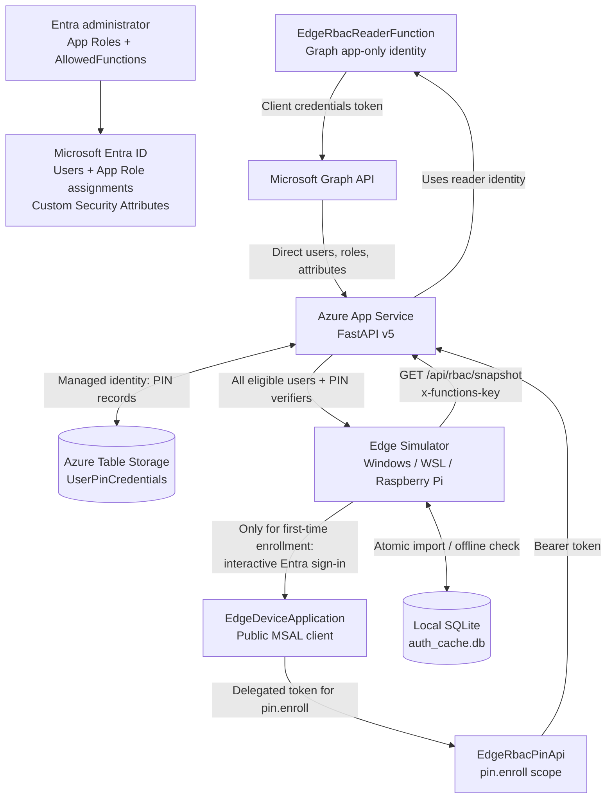
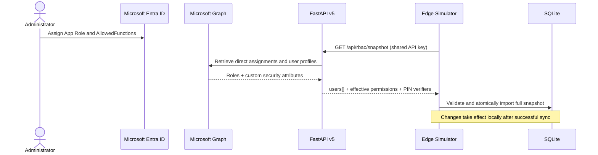
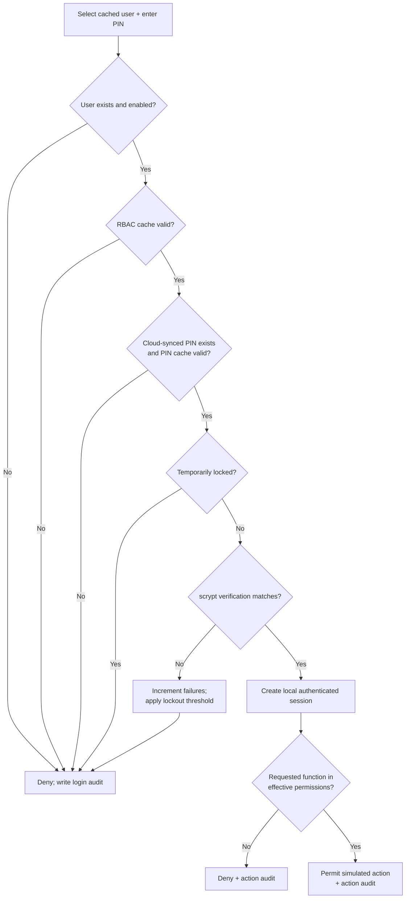

# Edge RBAC & Cloud PIN Synchronization POC

**Microsoft Entra ID · Azure App Service (FastAPI) · Microsoft Graph · Azure Table Storage · Python Edge Simulator · SQLite**

## Table of contents

1. [Executive overview](#1-executive-overview)
2. [Architecture](#2-architecture)
3. [Azure resources and Microsoft Entra applications](#3-azure-resources-and-microsoft-entra-applications)
4. [End-to-end workflows](#4-end-to-end-workflows)
5. [RBAC policy and supported functions](#5-rbac-policy-and-supported-functions)
6. [FastAPI backend: implementation and API contract](#6-fastapi-backend-implementation-and-api-contract)
7. [Edge Simulator: implementation and local data](#7-edge-simulator-implementation-and-local-data)
8. [Azure configuration and deployment](#8-azure-configuration-and-deployment)
9. [Edge installation and usage](#9-edge-installation-and-usage)
10. [Testing and troubleshooting](#10-testing-and-troubleshooting)
11. [Security model and limitations](#11-security-model-and-limitations)
12. [Next improvements](#12-next-improvements)

---

## 1. Executive overview

The POC demonstrates **centrally administered, locally enforced role-based access control (RBAC)** for a Python application simulating edge equipment on Windows, WSL2, or Raspberry Pi. Microsoft Entra ID is the source of user identity, application-role assignment, and selected per-user function permissions. Azure Table Storage is the source of enrolled PIN verifier records. An Azure-hosted FastAPI application assembles one snapshot containing **all directly assigned users**, their effective permissions, and their PIN verifier metadata. Each edge installation downloads that snapshot into its own SQLite database and uses it for offline PIN authentication and simulated feature authorization.

### Implemented capabilities

| Capability                 | Current implementation                                                                              |
| -------------------------- | --------------------------------------------------------------------------------------------------- |
| Central users              | Users from Microsoft Entra ID, limited to **direct** assignments to the edge Enterprise Application |
| Application roles          | `Operator`, `Supervisor`, `ServiceEnginner` (legacy spelling), `DeviceAdmin`                        |
| Fine-grained authorization | Intersection of App Role permissions and `EdgeAccess.AllowedFunctions` custom security attribute    |
| PIN creation               | 6–12 ASCII decimal digits; first-time **Entra-authenticated** cloud enrollment                      |
| Cloud PIN storage          | Salted scrypt verifier, **not the plaintext PIN**, in Azure Table Storage                           |
| Bulk synchronization       | `GET /api/rbac/snapshot`, protected by a shared `x-functions-key`                                   |
| Device registration        | **Not required** for RBAC/PIN synchronization; no RBAC device ID                                    |
| Edge cache                 | SQLite stores users, roles, effective permissions, PIN verifiers, expiries, and audits              |
| Offline login              | Verifies PIN locally without a cloud connection while both caches remain valid                      |
| Login protection           | Configurable failed-attempt threshold and local timed lockout                                       |
| User removal/revocation    | Reflected on the **next successful bulk synchronization** or denied after cache expiry              |
| Simulated functions        | Status, start operation, settings, service tools, user administration                               |
| Client interfaces          | Tkinter GUI and CLI; MSAL browser and device-code login for **PIN enrollment only**                 |
| Optional telemetry         | Separate simulated IoT Hub telemetry pipeline; **not** RBAC/PIN synchronization                     |
| Automated tests            | Backend and simulator unit/regression tests; live Azure integration requires separate validation    |

### Out of scope / not implemented

No actual industrial machine actuation; no centralized PIN reset/change endpoint; no device-specific RBAC authentication; no per-device revocation; no automatic scheduled RBAC/PIN refresh in the provided simulator; no expansion of group-based App Role assignments; no independent Graph `accountEnabled` check; no real-time offline revocation; and no production-grade secret protection or hardware-bound credentials.

---

## 2. Architecture

### 2.1 Logical architecture



The three App Registrations represent **application identities**, not three human logins or one registration per device/user. The actual PIN storage access is performed by the **App Service managed identity**. The Edge Simulator requires a human Entra sign-in **only to create a new cloud PIN**; routine bulk reads require the shared key instead.

### 2.2 Trust boundaries and credentials

| Boundary                      | Mechanism                                                                  | Access granted                                                        |
| ----------------------------- | -------------------------------------------------------------------------- | --------------------------------------------------------------------- |
| Edge → FastAPI bulk snapshot  | HTTPS plus shared `RBAC_API_KEY`, transmitted in `x-functions-key`         | Read **all eligible users'** RBAC details and active PIN verifiers    |
| User → FastAPI PIN enrollment | Entra delegated **access token** for `EdgeRbacPinApi`, scope `pin.enroll`  | Create the **authenticated user's** PIN for the first time            |
| FastAPI → Microsoft Graph     | OAuth client credentials using `EdgeRbacReaderFunction`                    | Read assigned users, roles, and authorized custom security attributes |
| FastAPI → Azure Table Storage | App Service system-assigned managed identity                               | Read active verifiers and create PIN records                          |
| User → edge offline session   | Locally verified PIN + unexpired SQLite authorization and credential cache | Access only functions in cached effective permissions                 |

**These credentials are not interchangeable.** The API key cannot create PINs; a Microsoft Graph `User.Read` access token is not a valid PIN-enrollment token; and the PIN-enrollment token is not used for bulk snapshot download.

---

## 3. Azure resources and Microsoft Entra applications

### 3.1 Azure services

| Resource                                           | Responsibility                                                            |
| -------------------------------------------------- | ------------------------------------------------------------------------- |
| Azure App Service (Linux / Python)                 | Hosts FastAPI and its OpenAPI/Swagger UI                                  |
| Azure Storage Account → `UserPinCredentials` table | Stores per-user salted PIN verifier records                               |
| App Service system-assigned managed identity       | Authenticates to Table Storage without a Storage connection-string secret |
| Microsoft Entra ID                                 | User identities, delegated sign-in, application roles, custom attributes  |
| Microsoft Graph                                    | API queried by FastAPI to construct the authorization snapshot            |
| Optional Azure IoT Hub                             | Receives independently simulated edge telemetry if configured             |

The Table Storage resource must grant the App Service identity **Storage Table Data Contributor**. The PIN table is **not** a device registry. No `EdgeDevices` table, `DEVICE_KEY_SHA256_JSON`, or `ALLOWED_DEVICE_IDS` setting is required by the v5 RBAC/PIN implementation.

### 3.2 Why three App Registrations?

| Registration               | Type and responsibility                                                                                        | Key configuration                                                                                           |
| -------------------------- | -------------------------------------------------------------------------------------------------------------- | ----------------------------------------------------------------------------------------------------------- |
| **EdgeDeviceApplication**  | Public-client application for browser/device-code user sign-in; source of App Role definitions and assignments | Public-client MSAL support; desktop redirect URI; user App Roles; delegated API permission for `pin.enroll` |
| **EdgeRbacReaderFunction** | Confidential backend identity for application-only Microsoft Graph access                                      | Graph application permissions and admin consent; client ID and secret configured in App Service             |
| **EdgeRbacPinApi**         | Protected resource API identifying the audience of PIN-enrollment access tokens                                | Application ID URI, enabled delegated scope `pin.enroll`, API access-token version expected by backend      |

**Microsoft Graph application permissions** used by the reader include `Application.Read.All`, `User.Read.All`, and `CustomSecAttributeAssignment.Read.All`, with administrator consent as required. These are powerful permissions and should be narrowed for production.

**Enterprise Application vs App Registration:** the App Registration defines an application's identity/configuration; its corresponding Enterprise Application (service principal) is where tenant user-to-App-Role assignments are administered. `EDGE_APP_SP_OBJECT_ID` is the **Enterprise Application service principal Object ID**, **not** its Application (Client) ID.

### 3.3 Configure authorization data

1. In **App registrations → EdgeDeviceApplication → App roles**, define/confirm the roles in the policy table below.
2. In **Enterprise applications → EdgeDeviceApplication → Users and groups**, assign **users directly** to their roles. The current reader ignores group principals and does not expand group membership.
3. In Entra's custom security attribute configuration, use set `EdgeAccess`, multi-valued string attribute `AllowedFunctions` and allowed values: `view_status`, `start_operation`, `change_settings`, `service_tools`, `user_admin`.
4. Assign the intended function values to each user and give the Graph reader permissions to read them. **Role assignment alone is insufficient**: the effective permission is the intersection of the role and custom-attribute values.
5. In **EdgeRbacPinApi → Expose an API**, expose and enable delegated scope `pin.enroll`.
6. In **EdgeDeviceApplication → API permissions**, add the `pin.enroll` delegated permission for `EdgeRbacPinApi`, then grant admin consent.

The historical `ServiceEnginner` role spelling is intentionally accepted in the code as an alias of `ServiceEngineer`; the value sent in snapshots is not silently renamed.

---

## 4. End-to-end workflows

### 4.1 Workflow A — An administrator changes authorization



1. Administrator updates the user's App Role and/or custom security attribute values.
2. During the next manual/CLI-triggered synchronization, FastAPI reads Microsoft Graph and calculates effective permissions.
3. FastAPI adds each eligible user's active Azure Table Storage PIN verifier to the same response.
4. The simulator validates the entire snapshot **before** beginning the database transaction; it then updates cached records atomically.
5. A removed user is disabled locally and their PIN verifier is deleted on the next successful full import. A failed download does not partially replace the local database.

### 4.2 Workflow B — First-time PIN enrollment

```mermaid
sequenceDiagram
    actor User
    participant Edge as Edge Simulator
    participant Entra as Microsoft Entra ID
    participant API as FastAPI v5
    participant Graph as Microsoft Graph
    participant Table as Azure Table Storage
    User->>Edge: Enroll New PIN (Browser / Device Code)
    Edge->>Entra: MSAL sign-in; request pin.enroll
    Entra-->>Edge: Delegated API access token + signed-in identity
    Edge->>API: GET /api/rbac/snapshot (shared key)
    API-->>Edge: Full current RBAC snapshot
    Note over Edge: Confirm signed-in OID is an authorized cached user
    User->>Edge: Enter and confirm 6–12 digit PIN
    Edge->>API: POST /api/pin/enroll (Bearer token + PIN)
    API->>Entra: Validate token signature/claims via Entra keys
    API->>Graph: Verify signed-in user has eligible direct App Role
    API->>Table: Create salted scrypt verifier (first enrollment only)
    Table-->>API: Stored
    API-->>Edge: HTTP 201 + PIN version
    Edge->>API: GET /api/rbac/snapshot (shared key)
    API-->>Edge: Updated full snapshot
    Edge->>Edge: Import verifier into local SQLite
```

**Code behavior:** `app/entra_auth.py` signs in with MSAL and requests `api://<PIN_API_CLIENT_ID>/pin.enroll`. `app/gui.py` first checks that the token's user Object ID exists in the fresh bulk snapshot. `POST /api/pin/enroll` validates the token and user's App Role again, hashes the PIN, and attempts a **create-only** Azure Table Storage write. On success, the client re-downloads the bulk snapshot. Re-enrollment returns **409 Conflict**; resetting an existing PIN has **not** been implemented.

The backend does **not** accept a username or Object ID supplied by the client to choose which account to enroll: it uses the validated token's `oid` claim.

### 4.3 Workflow C — Bulk synchronization on a new installation

1. Install the simulator and configure the FastAPI HTTPS base URL and identical shared `RBAC_API_KEY`.
2. Click **Sync All Users + PINs** or run `python -m app.cli sync`.
3. The simulator sends **one request**: `GET /api/rbac/snapshot` with `x-functions-key`.
4. The response contains all directly assigned users, their effective function permissions, and each user's enrolled verifier (or `pin: null`).
5. `app/bulk_sync.py` checks schema, timestamps, usernames/Object IDs, permissions, scrypt format, Base64 lengths, snapshot rollback, and PIN-version consistency; SQLite changes are committed together.
6. Any user with an enrolled PIN can subsequently log in offline at that installation **without performing a separate Entra sign-in on that installation**, while both caches remain valid.

No RBAC device ID is supplied in the request or returned in the response. The optional **IoT telemetry** feature has its own unrelated telemetry device identifier.

### 4.4 Workflow D — Offline PIN login and permission checks



`app/security.py` derives the scrypt key using the cached salt, compares it using `hmac.compare_digest`, tracks failures, and records login attempts. Defaults are **5 failed attempts** followed by a **300-second lockout** (per local installation). The simulator's GUI enables action buttons after successful local login, but authorization is also checked in the action layer; the CLI `action` path prompts for PIN again.

**Two independent expiries are enforced:** `validUntilUtc` for authorization and `pinValidUntilUtc` for the PIN verifier. The defaults are **168 hours (7 days)** and **24 hours**, respectively. With these defaults, offline PIN login cannot continue beyond 24 hours since the last successful bulk synchronization unless the cache is refreshed. These are **snapshot validity limits**, not the PIN's lifetime in the cloud.

### 4.5 Workflow E — Optional simulated IoT telemetry

The application can generate synthetic temperature, pressure, and machine-state events in local `telemetry.db`. A separate `app.sync_agent` service optionally forwards queued events to Azure IoT Hub and retries on failure. Its telemetry device identifier (from `IOTHUB_TELEMETRY_DEVICE_ID`) is **not** an RBAC authentication credential or required for bulk synchronization. The agent **does not automatically synchronize users or PINs**.

---

## 5. RBAC policy and supported functions

### 5.1 Roles and maximum role-defined permissions

| Entra App Role                               | Permissions permitted by the role                   |
| -------------------------------------------- | --------------------------------------------------- |
| `Operator`                                   | `view_status`, `start_operation`                    |
| `Supervisor`                                 | `view_status`, `start_operation`, `change_settings` |
| `ServiceEngineer` / legacy `ServiceEnginner` | `view_status`, `change_settings`, `service_tools`   |
| `DeviceAdmin`                                | All five supported functions                        |

### 5.2 Five simulated functions

| Function name     | GUI purpose                             |
| ----------------- | --------------------------------------- |
| `view_status`     | View simulated equipment status         |
| `start_operation` | Simulate initiating an operation        |
| `change_settings` | Simulate changing configuration         |
| `service_tools`   | Simulate access to maintenance tools    |
| `user_admin`      | Simulate user-administration privileges |

**Authorization rule (implemented in `backend/app/permissions.py`):**

```text
EffectivePermissions(user)
  = PermissionsFromRecognizedAppRoles(user)
      INTERSECT EdgeAccess.AllowedFunctions(user)
      INTERSECT SupportedFunctions
```

For example, an `Operator` with `AllowedFunctions = [view_status]` receives only `view_status`, not `start_operation`. Unknown roles or functions **do not grant permissions**. A missing attribute set gives **zero effective permissions**. The simulator uses the backend-calculated `permissions` array; it does **not** infer access independently from role names.

**Implementation limitation:** `graph_reader.py` sets `enabled: true` for users found through recognized direct role assignments. It does **not** check Microsoft Graph's actual `accountEnabled` property. A disabled Entra account with a still-existing direct App Role assignment may remain in the snapshot until the assignment is removed or the reader is enhanced.

---

## 6. FastAPI backend: implementation and API contract

### 6.1 Backend package layout

The supplied FastAPI v5 source ZIP extracts as follows:

```text
FastAPI-v5 source ZIP (contents at archive root)
├── main.py
├── requirements.txt
├── requirements-dev.txt
├── .env.example
├── README.md                      # Original package instructions
├── app/
│   ├── __init__.py
│   ├── config.py
│   ├── graph_reader.py
│   ├── permissions.py
│   ├── entra_token_auth.py
│   ├── pin_repository.py
│   └── pin_security.py
└── tests/
    └── test_bulk.py
```

| File                      | Actual code responsibility                                                                                                                           |
| ------------------------- | ---------------------------------------------------------------------------------------------------------------------------------------------------- |
| `main.py`                 | FastAPI routes, Pydantic models, dependency injection, shared-key comparison, enrollment authorization, snapshot assembly, security response headers |
| `app/config.py`           | Reads App Service environment settings, validates required fields and cache time ranges                                                              |
| `app/graph_reader.py`     | Uses Graph client-credentials flow, gets direct App Role assignments and user profiles, handles pagination/retries                                   |
| `app/permissions.py`      | App Role policy, legacy role alias, `AllowedFunctions` parsing and fail-closed intersection                                                          |
| `app/entra_token_auth.py` | Validates Microsoft Entra JWT signature, issuer, audience, tenant, expiry, authorized desktop client, delegated scope                                |
| `app/pin_repository.py`   | Uses managed identity and Azure Table Storage to read active PINs and create the first PIN record                                                    |
| `app/pin_security.py`     | PIN input checks, salt generation, scrypt verifier creation and verification utility                                                                 |
| `tests/test_bulk.py`      | Backend unit tests for API-key requirement, snapshot shape, failure handling, removed device route and enrollment boundary                           |

### 6.2 HTTP API reference

| HTTP method | Path                 | Auth                                 | Purpose                                                                                           |
| ----------- | -------------------- | ------------------------------------ | ------------------------------------------------------------------------------------------------- |
| `GET`       | `/`                  | None                                 | Service name and documentation location                                                           |
| `GET`       | `/health`            | None                                 | Basic process liveness; **does not test Graph or Storage health**                                 |
| `GET`       | `/api/rbac/snapshot` | `x-functions-key`                    | **Single bulk read** of all eligible users, roles, effective permissions and active PIN verifiers |
| `POST`      | `/api/pin/enroll`    | Entra Bearer token with `pin.enroll` | One-time enrollment of the authenticated user's PIN                                               |
| `GET`       | `/docs`              | Swagger UI                           | Interactive API documentation                                                                     |

**Intentionally removed:** `/api/device-access/{device_id}`, `/api/device-credentials/{device_id}`, `/api/access/snapshot`, `/api/pin/sync`, and `/api/pin/status`. There is no PIN reset/update API in this version.

#### Bulk snapshot request

```http
GET /api/rbac/snapshot HTTP/1.1
Host: <your-app>.azurewebsites.net
x-functions-key: <YOUR_RBAC_API_KEY>
Accept: application/json
```

The header name `x-functions-key` is retained for compatibility with earlier POC versions; this is still an **Azure App Service-hosted FastAPI route**, not an Azure Functions trigger.

#### Bulk snapshot response (illustrative; no real credentials)

```json
{
  "schemaVersion": 4,
  "version": 1794691200,
  "generatedUtc": "2026-11-14T16:00:00Z",
  "validUntilUtc": "2026-11-21T16:00:00Z",
  "pinValidUntilUtc": "2026-11-15T16:00:00Z",
  "source": {
    "assignmentMode": "direct-users-only",
    "servicePrincipalObjectId": "<edge-enterprise-app-object-id>"
  },
  "users": [
    {
      "entraObjectId": "<user-object-id>",
      "username": "operator@example.invalid",
      "displayName": "Example Operator",
      "enabled": true,
      "roles": ["Operator"],
      "permissions": ["view_status"],
      "pinEnrolled": true,
      "pin": {
        "algorithm": "scrypt-n16384-r8-p1-dk32",
        "saltBase64": "<BASE64_OF_16_BYTE_SALT>",
        "verifierBase64": "<BASE64_OF_32_BYTE_VERIFIER>",
        "pinVersion": 1
      }
    },
    {
      "entraObjectId": "<another-user-object-id>",
      "username": "newuser@example.invalid",
      "displayName": "New User",
      "enabled": true,
      "roles": ["Supervisor"],
      "permissions": [],
      "pinEnrolled": false,
      "pin": null
    }
  ]
}
```

**Field meaning:** `schemaVersion` describes the payload contract (currently **4**, despite backend version **5**). `version` is a generated Unix timestamp. `generatedUtc`, `validUntilUtc` and `pinValidUntilUtc` are UTC. `pin` is **salted verifier metadata**, never the plaintext PIN. The response is not a list of credentials for arbitrary Entra users: it contains **only users with recognized direct App Role assignments**.

`main.py` publishes the snapshot only if **both** Microsoft Graph and PIN repository reads succeed. A storage failure returns `503`, not a misleading user list with missing PINs.

#### PIN enrollment request

```http
POST /api/pin/enroll HTTP/1.1
Host: <your-app>.azurewebsites.net
Authorization: Bearer <ACCESS_TOKEN_FOR_EdgeRbacPinApi>
Content-Type: application/json
```

```json
{
  "pin": "<YOUR_6_TO_12_DIGIT_PIN>",
  "confirmPin": "<SAME_PIN>"
}
```

Successful first-time enrollment: HTTP **201**, for example:

```json
{ "status": "enrolled", "pinVersion": 1 }
```

The server checks that the PIN is 6–12 ASCII decimal digits and the confirmation matches. `PinStore.enroll_first_time()` uses Azure Tables `create_entity()` to reject overwrites; an existing record produces **409 Conflict**. PIN resets and rotations would require an additional authenticated, versioned workflow.

#### Authentication and error responses

| HTTP response | Common cause                                                                      |
| ------------- | --------------------------------------------------------------------------------- |
| `200`         | Valid bulk download                                                               |
| `201`         | New PIN enrolled                                                                  |
| `401`         | Missing/wrong shared key; missing/invalid enrollment Bearer token, claim or scope |
| `403`         | Entra-authenticated enrollment user lacks a recognized direct App Role assignment |
| `409`         | User's PIN entity already exists                                                  |
| `422`         | Invalid PIN/confirmation/request shape                                            |
| `502`         | Graph token/assignment/profile read failed                                        |
| `503`         | Required backend setting or Azure Table Storage unavailable                       |
| `404`         | Calling an old/deleted v2–v4 endpoint                                             |

All API responses set `Cache-Control: no-store`, `Pragma: no-cache`, and `X-Content-Type-Options: nosniff` in middleware.

### 6.3 Microsoft Graph reader details

`GraphReader.list_direct_users()`:

1. Acquires a Graph token at `/oauth2/v2.0/token` using `grant_type=client_credentials` and scope `https://graph.microsoft.com/.default`.
2. Reads the target service principal's `appRoles` definitions.
3. Reads `/servicePrincipals/{EDGE_APP_SP_OBJECT_ID}/appRoleAssignedTo` with paging, selecting **directly assigned user principals** with recognized roles.
4. Reads each eligible user's `id`, `displayName`, `userPrincipalName`, `mail`, and `customSecurityAttributes`.
5. Parses `EdgeAccess.AllowedFunctions`, computes effective permissions, and sorts the result.
6. Raises a directory error if a required lookup is malformed/unreliable; does not fabricate missing users or permissions.

The Graph helper retries selected transient HTTP statuses (`429`, `500`, `502`, `503`, `504`). It currently performs per-user profile reads, so large tenants would need more efficient paging/batching and stricter scoping.

### 6.4 Azure Table Storage record schema

Table: **`UserPinCredentials`**. Entity shape used by `PinStore`:

| Property         | Value                                  |
| ---------------- | -------------------------------------- |
| `PartitionKey`   | `PIN`                                  |
| `RowKey`         | Lowercase Entra user Object ID (`oid`) |
| `Algorithm`      | `scrypt-n16384-r8-p1-dk32`             |
| `SaltBase64`     | Base64-encoded random 16-byte salt     |
| `VerifierBase64` | Base64-encoded 32-byte scrypt result   |
| `PinVersion`     | `1` on first enrollment                |
| `Status`         | `Active`                               |
| `UpdatedAtUtc`   | Enrollment timestamp                   |

The backend uses `ManagedIdentityCredential` and `TableServiceClient`. Bulk reads query only partition `PIN`, then filter to eligible user OIDs and `Status == Active`. **The storage table never needs a column schema defined in advance.** The implementation does not store plaintext PINs.

**PIN KDF parameters:** `hashlib.scrypt(pin, salt=random_16_bytes, n=16384, r=8, p=1, dklen=32)`, with a constant-time comparison when verifying. This slows guessing but **does not make short numeric PIN verifiers safe to expose**.

---

## 7. Edge Simulator: implementation and local data

### 7.1 Simulator package layout

```text
Edge Simulator v5 ZIP (contents at archive root)
├── .env.example
├── .gitignore
├── README.md                         # Original simulator instructions
├── Run_Live_Mode_Windows.bat
├── run_live_linux.sh
├── requirements-live-minimal.txt
├── requirements.txt
├── install_wsl_service.sh
├── systemd/
│   └── edge-sync.service
├── app/
│   ├── __init__.py
│   ├── config.py
│   ├── cli.py
│   ├── gui.py
│   ├── entra_auth.py
│   ├── rbac_client.py
│   ├── bulk_sync.py
│   ├── db.py
│   ├── security.py
│   ├── authorization.py
│   ├── actions.py
│   ├── sync_agent.py
│   ├── iot_sender.py
│   ├── iot_sender_https.py
│   └── util.py
└── tests/
    └── test_v5_bulk.py
```

If placing both packages in one GitHub repository, a reasonable **proposed** structure is `backend/` and `edge-simulator/`, with this `README.md` at the repository root. This is an organization suggestion, not an assertion that the two ZIPs already contain those parent directories.

### 7.2 Main simulator modules

| File                    | Responsibility                                                                                                   |
| ----------------------- | ---------------------------------------------------------------------------------------------------------------- |
| `app/config.py`         | Reads `.env`, environment settings, SQLite paths, API URL/key, Entra app IDs and lockout policy                  |
| `app/gui.py`            | Tkinter UI: sync all, enroll new PIN, cached-user selection, offline login, simulated actions, audit display     |
| `app/cli.py`            | Headless commands for sync, PIN enrollment, users, status, offline login, action tests and synthetic telemetry   |
| `app/entra_auth.py`     | MSAL browser and device-code login for the `pin.enroll` API scope; obtains token and user Object ID              |
| `app/rbac_client.py`    | HTTPS requests; `fetch_bulk_snapshot()` sends `x-functions-key`; `enroll_pin()` sends an Entra Bearer token      |
| `app/bulk_sync.py`      | Validates schemaVersion 4, PIN hash encoding, identity uniqueness, expiry and rollback; commits a whole snapshot |
| `app/db.py`             | Creates SQLite schema, reads users/roles, stores PIN records and audits, updates synchronization state           |
| `app/security.py`       | Offline scrypt verification, credential expiry checks, failed-attempt lockout and login audit                    |
| `app/authorization.py`  | Recognizes exactly the five supported functions and checks effective permissions                                 |
| `app/actions.py`        | Applies function checks and logs allowed/denied **simulated** actions                                            |
| `app/sync_agent.py`     | Optional background telemetry forwarding; **does not refresh RBAC/PIN data**                                     |
| `app/iot_sender*.py`    | Optional IoT Hub telemetry senders                                                                               |
| `tests/test_v5_bulk.py` | Regression tests with synthetic snapshot and temporary SQLite databases                                          |

### 7.3 SQLite data stores and tables

Default file locations (relative to simulator working directory):

| File                 | Important tables / purpose                                                                                                  |
| -------------------- | --------------------------------------------------------------------------------------------------------------------------- |
| `data/auth_cache.db` | `users`, `roles`, `user_roles`, `user_permissions`, `offline_credentials`, `auth_sync_state`, `login_audit`, `action_audit` |
| `data/telemetry.db`  | `telemetry_events` for optional synthetic IoT telemetry                                                                     |
| `data/sync_state.db` | `telemetry_sync_state`; separate telemetry state, **not** the RBAC cache                                                    |

In `offline_credentials`, `salt_b64` and `verifier_b64` hold the downloaded verifier; `pin_version` must be at least `1`, and `credential_valid_until_utc` must be in the future. Older local-only PIN records (version `0`/no cloud version) are not accepted for offline login.

**Atomic import semantics:** `bulk_sync.import_bulk_snapshot()` validates records, starts a SQLite `BEGIN IMMEDIATE` transaction, updates users and role/permission relationships, upserts valid PIN verifiers, removes withdrawn/unenrolled verifiers, updates sync state and commits. On error, it rolls back. It rejects older generated timestamps, PIN-version rollback, or an unexpected change to the verifier without version increment. Existing local lockout counters are preserved when the PIN version is unchanged.

### 7.4 Why no device ID?

The chosen POC uses a **shared synchronization credential** across installations. Consequently:

- There is no RBAC device registration, per-device key pair, or device-ID route parameter.
- A brand-new installation can download every eligible user's records once it has the shared key.
- Device-level access cannot be selectively revoked without changing that credential everywhere.
- **Optional IoT Hub telemetry** may still use `IOTHUB_TELEMETRY_DEVICE_ID`; this identifies telemetry events only and is not used by FastAPI RBAC authentication.

---

## 8. Azure configuration and deployment

### 8.1 Prerequisites

- Microsoft Entra tenant with the three App Registrations, App Roles and per-user custom security attributes set up.
- App Service with Python runtime and a system-assigned managed identity enabled.
- Graph reader App Registration with required **application** permissions, admin consent, and a valid client secret.
- Storage Account containing Table `UserPinCredentials`.
- **Storage Table Data Contributor** granted to the App Service managed identity on the storage resource.
- `EdgeRbacPinApi` delegated `pin.enroll` scope enabled and granted to `EdgeDeviceApplication`.

### 8.2 FastAPI App Service environment variables

Configure under **Azure Portal → App Service → Settings → Environment variables**:

| Setting                          | Example / what to use                                          | Required for                          |
| -------------------------------- | -------------------------------------------------------------- | ------------------------------------- |
| `ENTRA_TENANT_ID`                | Your Entra tenant GUID                                         | Graph reads                           |
| `GRAPH_CLIENT_ID`                | `EdgeRbacReaderFunction` Application (Client) ID               | Graph reads                           |
| `GRAPH_CLIENT_SECRET`            | Graph reader's secret (keep confidential)                      | Graph reads                           |
| `EDGE_APP_SP_OBJECT_ID`          | `EdgeDeviceApplication` **Enterprise Application Object ID**   | Role-assignment discovery             |
| `RBAC_API_KEY`                   | Same long random secret configured on edge; **≥32 characters** | Bulk snapshot                         |
| `RBAC_CACHE_VALID_HOURS`         | `168` (allowed range 1–720)                                    | RBAC snapshot expiry                  |
| `PIN_CACHE_VALID_HOURS`          | `24` (allowed range 1–168)                                     | PIN snapshot expiry                   |
| `PIN_TABLE_ENDPOINT`             | `https://<storage-account>.table.core.windows.net`             | Cloud PIN repository                  |
| `PIN_TABLE_NAME`                 | `UserPinCredentials`                                           | Cloud PIN repository                  |
| `PIN_API_CLIENT_ID`              | `EdgeRbacPinApi` Application (Client) ID                       | PIN enrollment token validation       |
| `PIN_API_TENANT_ID`              | Entra tenant GUID (defaults to `ENTRA_TENANT_ID`)              | PIN enrollment token validation       |
| `EDGE_PUBLIC_CLIENT_ID`          | `EdgeDeviceApplication` Application (Client) ID                | Allowlisted caller for PIN enrollment |
| `SCM_DO_BUILD_DURING_DEPLOYMENT` | `true`                                                         | Azure Python ZIP build                |

**Remove obsolete device-RBAC settings:** `ALLOWED_DEVICE_IDS`, `DEVICE_KEY_SHA256_JSON`. Do not expose credentials in screenshots, source control, client logs, or README examples.

### 8.3 Deploy backend

1. Deploy the **FastAPI v5 Bulk Snapshot Deployment ZIP** (not v4) to the existing App Service using the portal deployment workflow.
2. Enable server-side dependency installation/build (do not skip the Oryx build).
3. Keep the Python startup command:

   ```bash
   gunicorn -w 2 -k uvicorn.workers.UvicornWorker -b 0.0.0.0:8000 main:app
   ```

4. Save environment settings and restart if needed.
5. Test `https://<your-app>.azurewebsites.net/health`, then `/docs`.
6. In Swagger, authorize the `x-functions-key` security scheme with the API key; call `GET /api/rbac/snapshot`. The Bearer security scheme is for **PIN enrollment**, not the shared-key snapshot.

Example CLI test (run from a trusted environment):

```bash
curl --fail-with-body \
  --header "x-functions-key: $RBAC_API_KEY" \
  "https://<your-app>.azurewebsites.net/api/rbac/snapshot"
```

### 8.4 Local backend development and tests

From the extracted backend source directory:

```bash
python -m venv .venv
# Activate the virtual environment for your operating system.
python -m pip install -r requirements.txt
python -m pip install -r requirements-dev.txt
python -m pytest -q
```

For local execution, ensure all required environment values are set and that Azure managed-identity authentication is available if testing the real Table Storage integration. **The supplied PIN repository explicitly uses `ManagedIdentityCredential`**, so a local Python session cannot automatically read the table with your ordinary Azure Portal login. Local unit tests use mocked dependencies and do not prove live storage connectivity.

---

## 9. Edge installation and usage

### 9.1 Configure the edge `.env`

Copy `.env.example` from the **simulator v5** package to `.env` and set:

```dotenv
# Base URL includes /api and excludes /rbac/snapshot.
RBAC_API_BASE_URL=https://<your-app>.azurewebsites.net/api
RBAC_API_KEY=<SAME_LONG_RANDOM_KEY_AS_FASTAPI>
RBAC_HTTP_TIMEOUT_SECONDS=25

# Needed ONLY for users enrolling a new PIN.
ENTRA_TENANT_ID=<TENANT_GUID>
EDGE_PUBLIC_CLIENT_ID=<EdgeDeviceApplication_CLIENT_ID>
PIN_API_CLIENT_ID=<EdgeRbacPinApi_CLIENT_ID>

# Offline storage and safeguards.
AUTH_DB_PATH=./data/auth_cache.db
TELEMETRY_DB_PATH=./data/telemetry.db
SYNC_STATE_DB_PATH=./data/sync_state.db
OFFLINE_AUTH_MAX_FAILED=5
OFFLINE_AUTH_LOCK_SECONDS=300
LOG_LEVEL=INFO

# Optional; NOT a FastAPI RBAC device identity.
IOTHUB_TELEMETRY_DEVICE_ID=EDGE-TELEMETRY-001
IOTHUB_DEVICE_CONNECTION_STRING=
```

`RBAC_API_KEY` is required for routine synchronization **and** for the GUI/CLI's current enrollment flow, because it refreshes the complete snapshot while enrolling. Keep `.env` and the SQLite database out of Git and accessible only to trusted OS users.

### 9.2 Windows

```powershell
# Run from the extracted simulator directory.
py -3 -m pip install -r requirements-live-minimal.txt
Copy-Item .env.example .env
# Edit .env with real service URL, API key, and Entra identifiers.
py -3 -m app.cli gui
```

Alternatively, double-click `Run_Live_Mode_Windows.bat`.

**GUI actions:**

- **Sync All Users + PINs** — downloads/imports the entire snapshot with the shared key.
- **Enroll New PIN — Browser** — requests `pin.enroll`, signs in via the browser, enrolls a new cloud PIN, then resynchronizes.
- **Enroll New PIN — Device Code** — same outcome using the Microsoft device-code flow, with a copyable code/URL.
- **Refresh Cached Users** — redisplays local SQLite records without downloading new cloud data.
- **Login Offline / Logout** — performs local PIN authentication and session management.
- **Five simulated function buttons / Show Audit** — locally check and display authorization decisions.

### 9.3 WSL2 / Raspberry Pi (Linux)

```bash
sudo apt-get update
sudo apt-get install -y python3-venv python3-tk
python3 -m venv .venv
source .venv/bin/activate
python -m pip install -r requirements-live-minimal.txt
cp .env.example .env
# Edit .env before running the cloud operations.
python -m app.cli gui
```

WSL requires WSLg/X11 for Tkinter; a Raspberry Pi needs an appropriate desktop environment. Headless systems should use the CLI. The optional telemetry sender depends on packages in the simulator's fuller `requirements.txt`.

### 9.4 CLI command reference

Execute from the simulator directory with its environment configured:

```bash
python -m app.cli init
python -m app.cli sync
python -m app.cli users
python -m app.cli status
python -m app.cli enroll --flow browser
python -m app.cli enroll --flow device
python -m app.cli login --username operator@example.invalid
python -m app.cli action --username operator@example.invalid --function view_status
python -m app.cli generate --count 3 --interval 1
```

| Command                                | Behavior                                                                                  |
| -------------------------------------- | ----------------------------------------------------------------------------------------- |
| `init`                                 | Initialize local SQLite tables                                                            |
| `sync`                                 | Bulk download and atomic import of **all** users and PIN verifiers                        |
| `users`                                | List cached users, roles, permissions and authorization expiry; does **not** display PINs |
| `status`                               | Show last RBAC synchronization state and errors                                           |
| `enroll --flow browser`                | First-time cloud PIN enrollment using browser/Entra token, then bulk refresh              |
| `enroll --flow device`                 | Same flow with a Microsoft device code                                                    |
| `login --username ...`                 | Prompt for PIN and verify it against local SQLite, offline                                |
| `action --username ... --function ...` | Prompt for PIN and simulate an authorized/denied function                                 |
| `generate`                             | Create optional local synthetic telemetry events                                          |

**Scheduling:** `app.sync_agent` does not refresh RBAC/PIN snapshots. To meet the default 24-hour PIN-cache limit on consistently online installations, schedule `python -m app.cli sync` with Windows Task Scheduler, cron, or a systemd timer at an interval **shorter than** the credential TTL. Scheduling is an operational choice and is **not preconfigured** by the supplied code.

---

## 10. Testing and troubleshooting

### 10.1 Automated tests actually checked

The source packages contain **5 backend tests** (`tests/test_bulk.py`) and **13 simulator tests** (`tests/test_v5_bulk.py`). They can be run independently from their respective package roots:

```bash
python -m pytest -q
```

The test suites exercise shared-key requirements, bulk schema/shape, non-partial failures, old-route removal, PIN-enrollment authentication boundary, multi-user SQLite imports, role/permission enforcement, offline verification, revoked users, PIN removal, expiry, rollback protection and HTTP header behavior. **These are local tests with mocked upstream dependencies or synthetic data**; live Entra/Graph/Table Storage integration and execution on actual Windows/WSL/Raspberry Pi installations remain environment-specific verification tasks.

### 10.2 Manual acceptance checklist

1. Configure at least two test users with direct App Role assignments and distinct allowed functions.
2. Confirm `/health` is healthy and `/api/rbac/snapshot` returns the users with the expected permission intersection.
3. Verify missing/wrong `x-functions-key` produces HTTP `401`.
4. Enroll a new test PIN through Entra browser/device-code flow; confirm first write returns `201`, second write returns `409`.
5. Run the edge bulk sync and confirm `users` and `offline_credentials` populate in `data/auth_cache.db`.
6. Verify correct PIN login succeeds, wrong PIN increments failures, and the threshold triggers timed lockout.
7. Verify a permitted simulated function succeeds and a disallowed function is denied.
8. Copy the simulator to a **fresh installation** with the same API key, synchronize, disconnect network and authenticate an already enrolled user offline.
9. Remove a user's direct App Role assignment, resync, and verify they are denied locally.
10. Expire the local PIN cache in a controlled test and confirm offline login fails closed.
11. If testing telemetry, separately verify synthetic event upload and retry behavior.

### 10.3 Frequent errors

| Symptom                                                              | Where to inspect / likely cause                                                                                                                                                                                   |
| -------------------------------------------------------------------- | ----------------------------------------------------------------------------------------------------------------------------------------------------------------------------------------------------------------- |
| `GET /api/rbac/snapshot` → **401**                                   | The edge `.env` key does not exactly match App Service `RBAC_API_KEY`, or key missing/too short                                                                                                                   |
| `GET /api/rbac/snapshot` → **502**                                   | Graph client secret, permissions/consent, Enterprise Application Object ID or Graph service failure                                                                                                               |
| `GET /api/rbac/snapshot` → **503**                                   | Table endpoint/name, managed identity role assignment, storage access, or backend configuration                                                                                                                   |
| `POST /api/pin/enroll` → **401**                                     | Invalid/expired JWT; wrong `aud`, `iss`, `tid`, `azp`, `scp`, token version, or signing-key validation. This **cannot** be fixed by sending the shared API key                                                    |
| `POST /api/pin/enroll` → **403**                                     | Signed-in account is not among recognized **directly assigned** users                                                                                                                                             |
| `POST /api/pin/enroll` → **409**                                     | A PIN entity already exists; no reset API in this version                                                                                                                                                         |
| `Signed-in user is not authorized in the current bulk RBAC snapshot` | The selected Entra account's `oid` does not match an enabled user in the fresh bulk snapshot; commonly an automatically selected browser SSO/admin account                                                        |
| Browser sign-in silently selects the wrong account                   | **As shipped**, `app/entra_auth.py` calls `acquire_token_interactive()` without `prompt="select_account"`. Account selection can be enabled in that source, or use device code in an InPrivate window for testing |
| Offline login rejected after sync                                    | No enrolled PIN, stale or invalid snapshot, local lockout, disabled/removed user, or wrong PIN                                                                                                                    |
| Old `/api/device-access/...` → **404**                               | FastAPI v5 removed device-scoped routes; use `/api/rbac/snapshot`                                                                                                                                                 |
| No automatic RBAC/PIN refresh                                        | Current GUI/CLI sync is manual unless separately scheduled; telemetry agent is independent                                                                                                                        |

**PIN-enrollment 401 diagnostic checklist:** Inspect the _decoded claims_ of the enrollment **access token** (do not paste the token into a ticket or repository): `ver=2.0`, `scp` contains `pin.enroll`, `aud` targets `EdgeRbacPinApi`, `azp` is the `EdgeDeviceApplication` client ID, and `tid`/`iss` match the expected tenant. Validate that `EdgeRbacPinApi` is configured to issue the expected v2 access token and `EdgeDeviceApplication` has consent to `pin.enroll`. If all claims appear correct, investigate Azure App Service logs/JWT validation. **The previously reported live 401 should not be marked resolved until the enrollment endpoint has been tested successfully.**

---

## 11. Security model and limitations

### 11.1 What is protected

- The bulk endpoint requires a configured shared API key (at least 32 characters); backend comparison uses `hmac.compare_digest`.
- PIN enrollment requires a valid, correctly scoped, Microsoft Entra-signed access token and eligible App Role assignment.
- Enrolled PINs are never returned or stored in plaintext after hashing; the verifier uses a random salt and scrypt.
- Import validation rejects malformed, expired, rolled-back or internally inconsistent snapshots.
- Offline access requires both unexpired authorization and PIN caches; known functions require explicit effective permissions.
- Local audit tables record attempted logins and simulated actions.
- Backend HTTP responses request `no-store` caching.

### 11.2 Important limitations of this POC

1. **High-impact verifier distribution:** Any client possessing `RBAC_API_KEY` can download **every eligible user's** salted PIN verifier. A leaked API key or SQLite file exposes low-entropy PIN material to **offline guessing attacks**; scrypt cannot eliminate this risk.
2. **Shared-key identity:** The API key does not distinguish machines or users. There is no per-device accountability, key rotation protocol, credential isolation, or device-level revocation.
3. **SQLite at rest:** The provided SQLite cache is not inherently encrypted. Protect it with OS file permissions and full-disk encryption; avoid shared/untrusted devices.
4. **Offline revocation delay:** Cloud role/attribute changes and removed PINs are enforced locally **only after a successful synchronization** or after cached authorization/PIN expiry. No immediate kill switch is implemented.
5. **Real account disablement:** The Graph reader does not evaluate the user's actual `accountEnabled` property. Remove direct assignments or extend the reader before claiming disabled users are automatically denied.
6. **Direct users only:** App Roles assigned via groups are not expanded.
7. **PIN policy and resets:** Numeric PINs have limited entropy. The backend supports create-only PIN enrollment, not forgotten-PIN recovery, reset, change, invalidation API or secure multi-factor local unlock.
8. **Local lockout only:** Lockouts and counters are stored in the installation's SQLite file; they are not synchronized or hardware enforced. A compromised device could tamper with its own cache.
9. **No TLS client binding / device attestation:** HTTPS protects transport, but this design does not authenticate a machine independently of the shared API key.
10. **Not real machine safety enforcement:** The five functions only simulate authorization and are not safety interlocks or secure controllers.
11. **Security Defaults and MFA:** Actual Entra sign-in protections depend on tenant configuration. If Security Defaults were disabled for the demo, restore appropriate MFA/Conditional Access before any real rollout.
12. **No automatic RBAC refresh:** An unattended machine can become locked out after PIN-cache expiry unless the sync command is separately scheduled and connected.

**Do not use this implementation to control real equipment or to protect sensitive operational privileges without a substantial production security redesign.** For a production architecture, favor per-device trust, stronger or hardware-backed user authentication, protected credential storage, scoped verification, auditable provisioning, true user-disabled checks and reliable revocation.

---

## 12. Next improvements

| Priority | Improvement                                                                                                         | Why it matters                                                                 |
| -------- | ------------------------------------------------------------------------------------------------------------------- | ------------------------------------------------------------------------------ |
| High     | Resolve the current `POST /api/pin/enroll` **401** in the live tenant and complete a full first-enrollment E2E test | The cloud PIN enrollment path is not yet confirmed working in that environment |
| High     | Update browser MSAL login to explicitly prompt for account selection (or provide account choice)                    | Avoid accidental use of the browser's default SSO identity                     |
| High     | Protect the shared key and SQLite database; plan a replacement for bulk low-entropy verifier distribution           | Major credential disclosure and offline PIN-guessing risk                      |
| High     | Read and enforce Microsoft Graph `accountEnabled`; define a policy for group assignments                            | Authorization correctness                                                      |
| Medium   | Implement a secure, authenticated PIN reset/change flow with incremented `PinVersion` and audit                     | Account lifecycle support                                                      |
| Medium   | Configure reliable scheduled bulk refresh and monitoring before the 24-hour PIN-cache deadline                      | Continued offline operation within policy                                      |
| Medium   | Add Key Vault-backed secrets and stronger operational logging (without tokens/PINs)                                 | Secret management and incident response                                        |
| Medium   | Add integration tests for actual Entra tokens, Graph assignments, managed identity and Azure Table Storage          | Current unit tests cannot prove cloud connectivity                             |
| Future   | Build an administrator-facing UI with appropriately protected backend management endpoints                          | Centralized access administration without routine Azure Portal usage           |
| Future   | Replace shared key with per-device identity and hardware-bound credentials if moving beyond the POC                 | Enterprise-scale, auditable device lifecycle                                   |

---

## Repository and version notes

The `POST /api/pin/enroll` route and the `GET /api/rbac/snapshot` route are **different trust levels by design**. The shared API key downloads all-user data, whereas a human user's validated Entra access token is required to create the initial PIN. Do not merge those authorization checks.

**License, authorship, deployment status, and organization-specific contact information:** add these after deciding whether the repository will be private or public. Never put real PINs, access tokens, API keys, client secrets, or exported verifier records into the repository.
